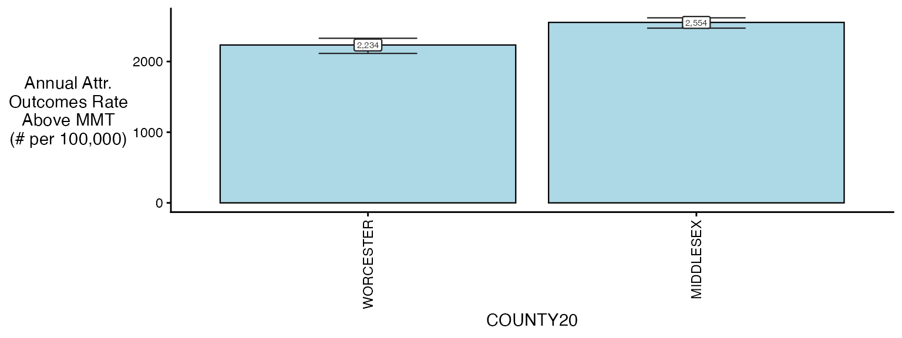
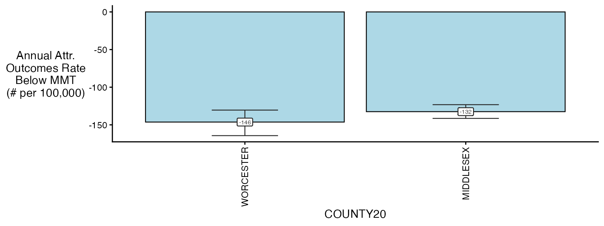
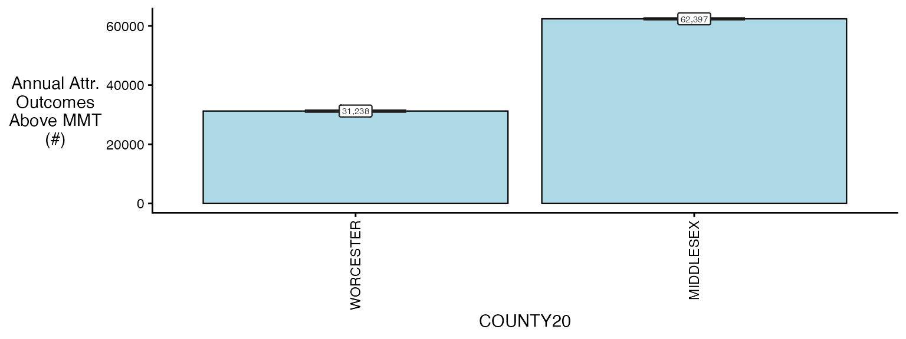
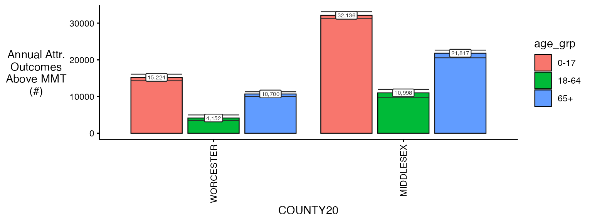
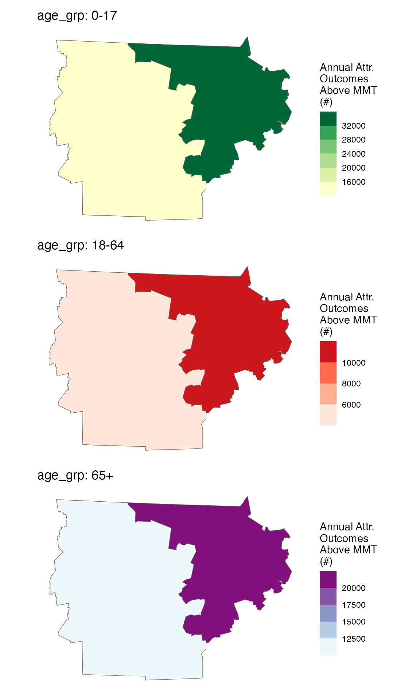

# Calculating attributable numbers and rates in \`cityClimateHealth\`

``` r

library(cityClimateHealth)
```

Estimating Attributable numbers (and rates of attributable numbers) are
a key way that we can translate relative risks into numbers that are
more tangible in public health settings. Below we provide easy
functionality to go from our model objects to estimates of attributable
numbers and rates.

### Setup

The first step of calculating attributable numbers is having a
population data estimate.

This varies a lot by place and dataset, so we don’t include
functionality for it (but an example of how this could be done can be
seen in the [population estimates
article](https://climatehealth.city/articles/get_pop_estimates.md)).

Reminder - the data used in this example are **simulated**.

Assume you are starting with a dataset for the entire timeframe that
looks like this:

``` r

library(data.table)
data("ma_pop_data")
setDT(ma_pop_data)
ma_pop_data
#>               TOWN20 Female_0-17 Female_18-64 Female_65+ Male_0-17 Male_18-64
#>               <char>       <num>        <num>      <num>     <num>      <num>
#>   1:      BARNSTABLE        3899        15017       6014      4499      14035
#>   2:          BOURNE        1891         5751       3212      1489       5302
#>   3:        BREWSTER         634         2518       2007       833       2628
#>   4:         CHATHAM         163         1477       1759       480       1265
#>   5:          DENNIS         573         3792       3133       784       4101
#>  ---                                                                         
#> 347:   WEST BOYLSTON         619         2021       1107       604       2554
#> 348: WEST BROOKFIELD         343         1162        578       243       1002
#> 349:     WESTMINSTER         847         2371       1131       762       2028
#> 350:      WINCHENDON        1254         3318        711      1031       3134
#> 351:       WORCESTER       18779        67750      15995     21129      69365
#>      Male_65+
#>         <num>
#>   1:     5458
#>   2:     2810
#>   3:     1721
#>   4:     1463
#>   5:     2359
#>  ---         
#> 347:      790
#> 348:      495
#> 349:     1081
#> 350:      924
#> 351:    11173
```

Need to do some transformations:

- pivot longer
- variable clean

Note again, this processing will vary by application so this approach is
not prescriptive !

Pivot longer:

``` r

ma_pop_data_long <- melt(
  ma_pop_data,
  id.vars = "TOWN20",
  variable.name = "sex_age",
  value.name = "population"
)
```

Variable clean:

``` r

ma_pop_data_long$sex_age <- as.character(ma_pop_data_long$sex_age)
varnames <- strsplit(ma_pop_data_long$sex_age, "_", fixed = T)
varnames <- data.frame(do.call(rbind, varnames))
names(varnames) <- c('sex', 'age_grp')
rr <- which(varnames$sex == 'Female')
varnames$sex[rr] <- 'F'
rr <- which(varnames$sex == 'Male')
varnames$sex[rr] <- 'M'
ma_pop_data_long$sex = varnames$sex
ma_pop_data_long$age_grp = varnames$age_grp
ma_pop_data_long$sex_age <- NULL
ma_pop_data_long
#>                TOWN20 population    sex age_grp
#>                <char>      <num> <char>  <char>
#>    1:      BARNSTABLE       3899      F    0-17
#>    2:          BOURNE       1891      F    0-17
#>    3:        BREWSTER        634      F    0-17
#>    4:         CHATHAM        163      F    0-17
#>    5:          DENNIS        573      F    0-17
#>   ---                                          
#> 2102:   WEST BOYLSTON        790      M     65+
#> 2103: WEST BROOKFIELD        495      M     65+
#> 2104:     WESTMINSTER       1081      M     65+
#> 2105:      WINCHENDON        924      M     65+
#> 2106:       WORCESTER      11173      M     65+
```

We assume that these properties hold for the entire timeframe of our
analysis, but you could also make a version of this dataset with a
‘year’ column.

Now, quickly get a
[`condPois_1stage()`](https://climatehealth.city/reference/condPois_1stage.md)
and
[`condPois_2stage()`](https://climatehealth.city/reference/condPois_2stage.md)
objects to use in testing: exposures

``` r

library(data.table)
exposure_columns <- list(
  "date" = "date",
  "exposure" = "tmax_C",
  "geo_unit" = "TOWN20",
  "geo_unit_grp" = "COUNTY20"
)

ma_exposure_matrix <- make_exposure_matrix(
  subset(ma_exposure, COUNTY20 %in% c('MIDDLESEX', 'WORCESTER')), 
  exposure_columns,
  time_subset = list(month = 5:9,
                     year = 2013:2015))
#> -- NA values automatically removed
#> strata dt_by = 'day', setting strata as geo_unit:yr:mn:dow
```

outcomes

``` r

outcome_columns <- list(
  "date" = "date",
  "outcome" = "daily_deaths",
  "geo_unit" = "TOWN20",
  "geo_unit_grp" = "COUNTY20"
)

ma_outcomes_tbl <- make_outcome_table(
  subset(ma_deaths,COUNTY20 %in% c('MIDDLESEX', 'WORCESTER')),
  outcome_columns,
  time_subset = list(month = 5:9,
                   year = 2012:2015))
#> Missing outcome values introduced by xgrid were set to 0;
#>             assumes that every time in the dataset should have an outcome value
#> strata dt_by = 'day', setting strata as geo_unit:yr:mn:dow
```

models

``` r

ma_model <- condPois_2stage(ma_exposure_matrix, ma_outcomes_tbl, verbose = 1, global_cen = 20)
#> -- validation passed
#> -- stage 1
#> 
#> crossbasis args for geo_unit  ACTON :
#> 
#> maxlag: 5 
#> 
#> argvar:
#> List of 2
#>  $ fun  : chr "ns"
#>  $ knots: Named num [1:2] 25.6 31.3
#>   ..- attr(*, "names")= chr [1:2] "50%" "90%"
#> 
#> arglag:
#> List of 2
#>  $ fun  : chr "ns"
#>  $ knots: num [1:2] 0.878 2.095
#> 
#> strata:
#> ACTON:yr2013:mn05:dow04
#> strata_min: 0 
#> 
#> min_n: 50 
#> 
#> truncate final RR and basis cen:  0 
#> formula:
#>    daily_deaths ~ cb
#> family: quasipoisson
#> 
#> -- mixmeta
#> formula: coef_matrix ~ exp_mean + exp_IQR
#> random: ~ 1 | COUNTY20/TOWN20 
#> -- stage 2
#> truncate final RR and basis cen:  0.01
```

### Estimating the AN

Ok so now you pass in `population`.

So now estimate the AN as a full object

Remember that this needs to be compatible for:

- single zone

- ma model with ma_model\$`_`

- ma model with factor ma_model\$`0-17` \> I think you can handle this
  the same way you did before, with recursion

Now in this second step, you can choose the aggregation level that you
want results to.

In this block you need:

- what spatial resolution are you summarizing to: -\>\> ‘geo_unit’,
  ‘geo_unit_grp’, or ‘all’

- are you just getting the impacts that are \> then the centering point:
  -\>\> lets just assume yes for now, can always go back and change it

``` r

ma_AN <- calc_AN(ma_model, ma_outcomes_tbl, ma_pop_data_long,
                 spatial_agg_type = 'TOWN20', 
                 spatial_join_col = 'TOWN20', 
                 nsim = 100,
                 verbose = 2)
#> -- validation passed
#> -- estimate in each geo_unit
#> 5    10  15  20  25  30  35  40  45  50  55  60  65  70  75  80  85  90  95  100     105     110     
#> -- summarize by simulation
#> 5    10  15  20  25  30  35  40  45  50  55  60  65  70  75  80  85  90  95  100     
#> -- applying scale of :  1
ma_AN$`_`$rate_table
#>          TOWN20  COUNTY20 population above_MMT mean_annual_attr_rate_est
#>          <char>    <char>      <num>    <lgcl>                     <num>
#>   1:      ACTON MIDDLESEX      23864      TRUE                 2501.1524
#>   2:      ACTON MIDDLESEX      23864     FALSE                 -140.3788
#>   3:  ARLINGTON MIDDLESEX      45906      TRUE                 2609.4084
#>   4:  ARLINGTON MIDDLESEX      45906     FALSE                 -153.8470
#>   5: ASHBURNHAM WORCESTER       6337      TRUE                 1714.1392
#>  ---                                                                    
#> 224: WINCHESTER MIDDLESEX      22809     FALSE                 -201.1267
#> 225:     WOBURN MIDDLESEX      40992      TRUE                 2509.0262
#> 226:     WOBURN MIDDLESEX      40992     FALSE                 -103.3738
#> 227:  WORCESTER WORCESTER     204191      TRUE                 2280.5241
#> 228:  WORCESTER WORCESTER     204191     FALSE                 -177.6523
#>      mean_annual_attr_rate_lb mean_annual_attr_rate_ub
#>                         <num>                    <num>
#>   1:                1877.7761               3089.61721
#>   2:                -217.6657                -73.77745
#>   3:                2172.0881               3043.66532
#>   4:                -215.9712               -100.32730
#>   5:                1242.5043               2132.61401
#>  ---                                                  
#> 224:                -263.6295               -138.10338
#> 225:                1934.3408               3020.20821
#> 226:                -151.8894                -52.43401
#> 227:                1949.3513               2689.89573
#> 228:                -257.8193               -119.07969
ma_AN$`_`$number_table
#>          TOWN20  COUNTY20 population above_MMT mean_annual_attr_num_est
#>          <char>    <char>      <num>    <lgcl>                    <num>
#>   1:      ACTON MIDDLESEX      23864      TRUE                  596.875
#>   2:      ACTON MIDDLESEX      23864     FALSE                  -33.500
#>   3:  ARLINGTON MIDDLESEX      45906      TRUE                 1197.875
#>   4:  ARLINGTON MIDDLESEX      45906     FALSE                  -70.625
#>   5: ASHBURNHAM WORCESTER       6337      TRUE                  108.625
#>  ---                                                                   
#> 224: WINCHESTER MIDDLESEX      22809     FALSE                  -45.875
#> 225:     WOBURN MIDDLESEX      40992      TRUE                 1028.500
#> 226:     WOBURN MIDDLESEX      40992     FALSE                  -42.375
#> 227:  WORCESTER WORCESTER     204191      TRUE                 4656.625
#> 228:  WORCESTER WORCESTER     204191     FALSE                 -362.750
#>      mean_annual_attr_num_lb mean_annual_attr_num_ub
#>                        <num>                   <num>
#>   1:               448.11250               737.30625
#>   2:               -51.94375               -17.60625
#>   3:               997.11875              1397.22500
#>   4:               -99.14375               -46.05625
#>   5:                78.73750               135.14375
#>  ---                                                
#> 224:               -60.13125               -31.50000
#> 225:               792.92500              1238.04375
#> 226:               -62.26250               -21.49375
#> 227:              3980.40000              5492.52500
#> 228:              -526.44375              -243.15000
```

you can change `spatial_agg_type` to be a different spatial resolution –
either whatever the group variable was or “all”

``` r

ma_AN <- calc_AN(ma_model, ma_outcomes_tbl, ma_pop_data_long,
                 spatial_agg_type = 'COUNTY20', 
                 spatial_join_col = 'TOWN20', 
                 nsim = 100,
                 verbose = 2)
#> -- validation passed
#> -- estimate in each geo_unit
#> 5    10  15  20  25  30  35  40  45  50  55  60  65  70  75  80  85  90  95  100     105     110     
#> -- summarize by simulation
#> 5    10  15  20  25  30  35  40  45  50  55  60  65  70  75  80  85  90  95  100     
#> -- applying scale of :  1
ma_AN$`_`$rate_table
#>     COUNTY20 population above_MMT mean_annual_attr_rate_est
#>       <char>      <num>    <lgcl>                     <num>
#> 1: MIDDLESEX    1623109      TRUE                 2553.7949
#> 2: MIDDLESEX    1623109     FALSE                 -132.5003
#> 3: WORCESTER     858898      TRUE                 2234.0546
#> 4: WORCESTER     858898     FALSE                 -146.3067
#>    mean_annual_attr_rate_lb mean_annual_attr_rate_ub
#>                       <num>                    <num>
#> 1:                2472.4133                2618.5218
#> 2:                -141.4592                -123.2269
#> 3:                2114.9797                2329.2572
#> 4:                -164.3538                -130.4208
ma_AN$`_`$number_table
#>     COUNTY20 population above_MMT mean_annual_attr_num_est
#>       <char>      <num>    <lgcl>                    <num>
#> 1: MIDDLESEX    1623109      TRUE                41450.875
#> 2: MIDDLESEX    1623109     FALSE                -2150.625
#> 3: WORCESTER     858898      TRUE                19188.250
#> 4: WORCESTER     858898     FALSE                -1256.625
#>    mean_annual_attr_num_lb mean_annual_attr_num_ub
#>                      <num>                   <num>
#> 1:               40129.963               42501.463
#> 2:               -2296.038               -2000.106
#> 3:               18165.519               20005.944
#> 4:               -1411.631               -1120.181
```

See that the numbers are roughly the same for Suffolk county ? They
won’t be exactly the same because of how the averaging works.

Some plot functions exist:

``` r

plot(ma_AN, table_type = 'rate', above_MMT = T)
```



``` r

plot(ma_AN, table_type = 'rate', above_MMT = F)
```



### Estimating the AN - single

check of single

``` r


# run the model
m2 <- condPois_1stage(exposure_matrix = ma_exposure_matrix, 
                  outcomes_tbl = ma_outcomes_tbl, 
                  multi_zone = TRUE, global_cen = 15)
#> 
#> crossbasis args for geo_unit  ACTON,ARLINGTON,ASHBURNHAM,ASHBY,ASHLAND,ATHOL,AUBURN,AYER,BARRE,BEDFORD,BELMONT,BERLIN,BILLERICA,BLACKSTONE,BOLTON,BOXBOROUGH,BOYLSTON,BROOKFIELD,BURLINGTON,CAMBRIDGE,CARLISLE,CHARLTON,CHELMSFORD,CLINTON,CONCORD,DOUGLAS,DRACUT,DUDLEY,DUNSTABLE,EAST BROOKFIELD,EVERETT,FITCHBURG,FRAMINGHAM,GARDNER,GRAFTON,GROTON,HARDWICK,HARVARD,HOLDEN,HOLLISTON,HOPEDALE,HOPKINTON,HUBBARDSTON,HUDSON,LANCASTER,LEICESTER,LEOMINSTER,LEXINGTON,LINCOLN,LITTLETON,LOWELL,LUNENBURG,MALDEN,MARLBOROUGH,MAYNARD,MEDFORD,MELROSE,MENDON,MILFORD,MILLBURY,MILLVILLE,NATICK,NEW BRAINTREE,NEWTON,NORTH BROOKFIELD,NORTH READING,NORTHBOROUGH,NORTHBRIDGE,OAKHAM,OXFORD,PAXTON,PEPPERELL,PETERSHAM,PHILLIPSTON,PRINCETON,READING,ROYALSTON,RUTLAND,SHERBORN,SHIRLEY,SHREWSBURY,SOMERVILLE,SOUTHBOROUGH,SOUTHBRIDGE,SPENCER,STERLING,STONEHAM,STOW,STURBRIDGE,SUDBURY,SUTTON,TEMPLETON,TEWKSBURY,TOWNSEND,TYNGSBOROUGH,UPTON,UXBRIDGE,WAKEFIELD,WALTHAM,WARREN,WATERTOWN,WAYLAND,WEBSTER,WEST BOYLSTON,WEST BROOKFIELD,WESTBOROUGH,WESTFORD,WESTMINSTER,WESTON,WILMINGTON,WINCHENDON,WINCHESTER,WOBURN,WORCESTER :
#> 
#> maxlag: 5 
#> 
#> argvar:
#> List of 2
#>  $ fun  : chr "ns"
#>  $ knots: Named num [1:2] 25.3 30.3
#>   ..- attr(*, "names")= chr [1:2] "50%" "90%"
#> 
#> arglag:
#> List of 2
#>  $ fun  : chr "ns"
#>  $ knots: num [1:2] 0.878 2.095
#> 
#> strata:
#> ACTON:yr2013:mn05:dow04
#> strata_min: 0 
#> 
#> min_n: 50 
#> 
#> truncate final RR and basis cen:  0.025 
#> formula:
#>    daily_deaths ~ cb
#> family: quasipoisson

ma_AN_s1 <- calc_AN(m2, ma_outcomes_tbl, ma_pop_data_long,
                 spatial_agg_type = 'COUNTY20', 
                 spatial_join_col = 'TOWN20', 
                 nsim = 100,
                 verbose = 2)
#> -- validation passed
#> -- estimate in each geo_unit
#> 5    10  15  20  25  30  35  40  45  50  55  60  65  70  75  80  85  90  95  100     105     110     
#> -- summarize by simulation
#> 5    10  15  20  25  30  35  40  45  50  55  60  65  70  75  80  85  90  95  100     
#> -- applying scale of :  1

ma_AN_s1$`_`$rate_table
#>     COUNTY20 population above_MMT mean_annual_attr_rate_est
#>       <char>      <num>    <lgcl>                     <num>
#> 1: MIDDLESEX    1623109      TRUE               3844.273552
#> 2: MIDDLESEX    1623109     FALSE                 -3.634999
#> 3: WORCESTER     858898      TRUE               3636.942338
#> 4: WORCESTER     858898     FALSE                 -4.628023
#>    mean_annual_attr_rate_lb mean_annual_attr_rate_ub
#>                       <num>                    <num>
#> 1:              3824.148209              3864.370785
#> 2:                -3.774392                -3.542584
#> 3:              3591.088523              3674.891402
#> 4:                -4.889987                -4.307846
plot(ma_AN_s1, "num", above_MMT = T)
```



### Estimating the AN - with factors

In the case where you have factors, you can easily extend this

``` r


outcome_columns <- list(
  "date" = "date",
  "outcome" = "daily_deaths",
  "factor" = "age_grp",
  "geo_unit" = "TOWN20",
  "geo_unit_grp" = "COUNTY20"
)

ma_outcomes_tbl_fct <- make_outcome_table(
  subset(ma_deaths,COUNTY20 %in% c('MIDDLESEX', 'WORCESTER')), 
  outcome_columns, 
  time_subset = list(month = 5:9, year = 2012:2015))
#> > Combined factor is  age_grp
#> Missing outcome values introduced by xgrid were set to 0;
#>             assumes that every time in the dataset should have an outcome value
#> strata dt_by = 'day', setting strata as geo_unit:yr:mn:dow

ma_model_fct <- condPois_2stage(ma_exposure_matrix, 
                                ma_outcomes_tbl_fct, 
                                global_cen = 15,
                                verbose = 1)
#> < age_grp : 0-17 >
#> -- validation passed
#> -- stage 1
#> 
#> crossbasis args for geo_unit  ACTON :
#> 
#> maxlag: 5 
#> 
#> argvar:
#> List of 2
#>  $ fun  : chr "ns"
#>  $ knots: Named num [1:2] 25.6 31.3
#>   ..- attr(*, "names")= chr [1:2] "50%" "90%"
#> 
#> arglag:
#> List of 2
#>  $ fun  : chr "ns"
#>  $ knots: num [1:2] 0.878 2.095
#> 
#> strata:
#> ACTON:yr2013:mn05:dow04
#> strata_min: 0 
#> 
#> min_n: 50 
#> 
#> truncate final RR and basis cen:  0 
#> formula:
#>    daily_deaths ~ cb
#> family: quasipoisson
#> 
#> -- mixmeta
#> formula: coef_matrix ~ exp_mean + exp_IQR
#> random: ~ 1 | COUNTY20/TOWN20 
#> -- stage 2
#> truncate final RR and basis cen:  0.01 
#> 
#> < age_grp : 18-64 >
#> -- validation passed
#> -- stage 1
#> 
#> crossbasis args for geo_unit  ACTON :
#> 
#> maxlag: 5 
#> 
#> argvar:
#> List of 2
#>  $ fun  : chr "ns"
#>  $ knots: Named num [1:2] 25.6 31.3
#>   ..- attr(*, "names")= chr [1:2] "50%" "90%"
#> 
#> arglag:
#> List of 2
#>  $ fun  : chr "ns"
#>  $ knots: num [1:2] 0.878 2.095
#> 
#> strata:
#> ACTON:yr2013:mn05:dow04
#> strata_min: 0 
#> 
#> min_n: 50 
#> 
#> truncate final RR and basis cen:  0 
#> formula:
#>    daily_deaths ~ cb
#> family: quasipoisson
#> 
#> -- mixmeta
#> formula: coef_matrix ~ exp_mean + exp_IQR
#> random: ~ 1 | COUNTY20/TOWN20 
#> -- stage 2
#> truncate final RR and basis cen:  0.01 
#> 
#> < age_grp : 65+ >
#> -- validation passed
#> -- stage 1
#> 
#> crossbasis args for geo_unit  ACTON :
#> 
#> maxlag: 5 
#> 
#> argvar:
#> List of 2
#>  $ fun  : chr "ns"
#>  $ knots: Named num [1:2] 25.6 31.3
#>   ..- attr(*, "names")= chr [1:2] "50%" "90%"
#> 
#> arglag:
#> List of 2
#>  $ fun  : chr "ns"
#>  $ knots: num [1:2] 0.878 2.095
#> 
#> strata:
#> ACTON:yr2013:mn05:dow04
#> strata_min: 0 
#> 
#> min_n: 50 
#> 
#> truncate final RR and basis cen:  0 
#> formula:
#>    daily_deaths ~ cb
#> family: quasipoisson
#> 
#> -- mixmeta
#> formula: coef_matrix ~ exp_mean + exp_IQR
#> random: ~ 1 | COUNTY20/TOWN20 
#> -- stage 2
#> truncate final RR and basis cen:  0.01

ma_AN_fct <- calc_AN(ma_model_fct, ma_outcomes_tbl_fct,
                     ma_pop_data_long,
                 spatial_agg_type = 'COUNTY20', 
                 spatial_join_col = 'TOWN20', 
                 nsim = 100,
                 verbose = 1)
#> -- over-writing `scale` argument with factor scales
#> < age_grp : 0-17 >
#> Warning in calc_AN(model = sub_model, outcomes_tbl = sub_outcomes_tbl, pop_data
#> = sub_pop_data, : some pop data are zero
#> -- validation passed
#> -- estimate in each geo_unit
#> -- summarize by simulation
#> < age_grp : 18-64 >
#> -- validation passed
#> -- estimate in each geo_unit
#> -- summarize by simulation
#> < age_grp : 65+ >
#> -- validation passed
#> -- estimate in each geo_unit
#> -- summarize by simulation

plot(ma_AN_fct, "num", above_MMT = T)
```



These results are fictional of course but show what kind of outputs can
be made easily.

``` r

spatial_plot(ma_AN_fct, shp = ma_counties, table_type = "num", above_MMT = T)
```


