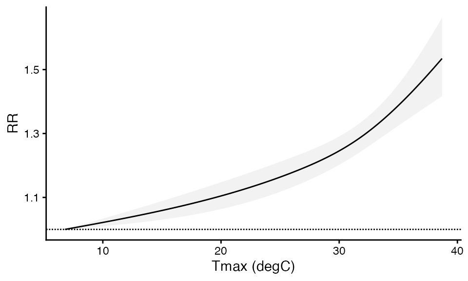
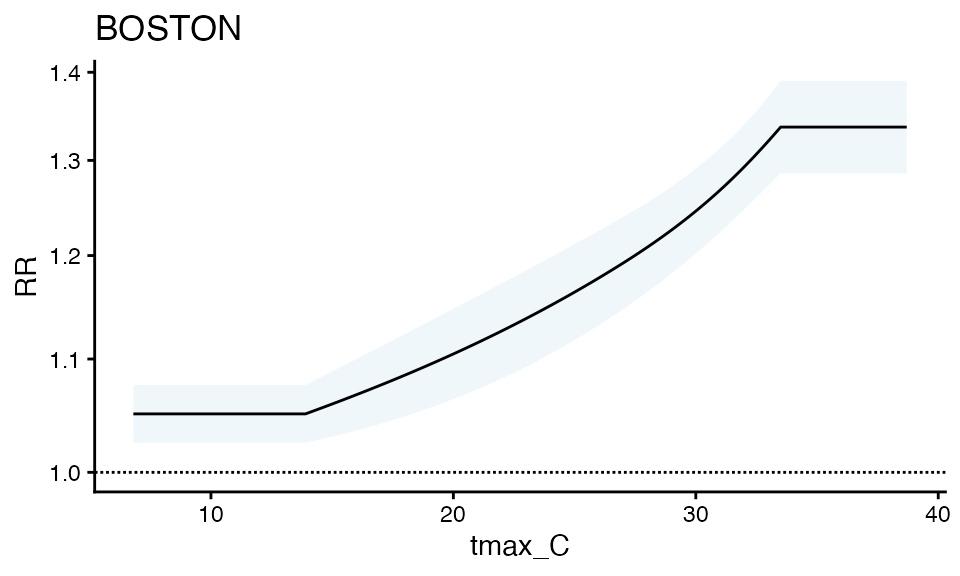
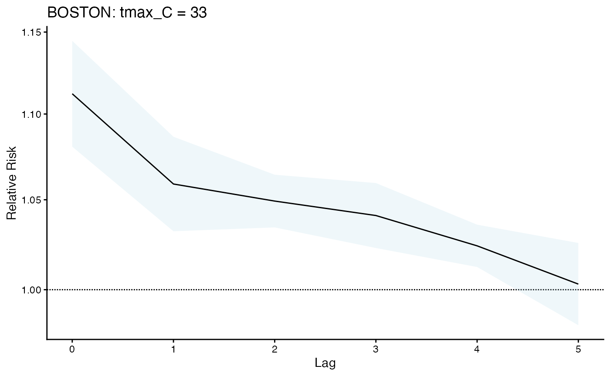
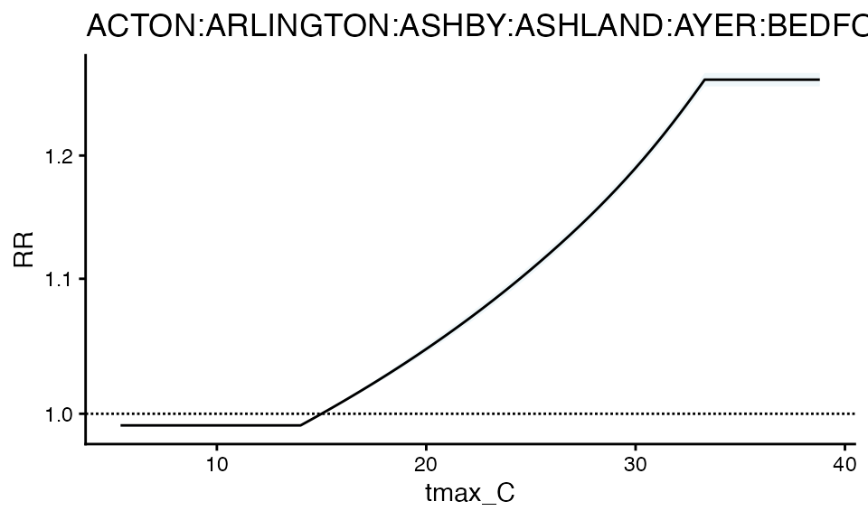
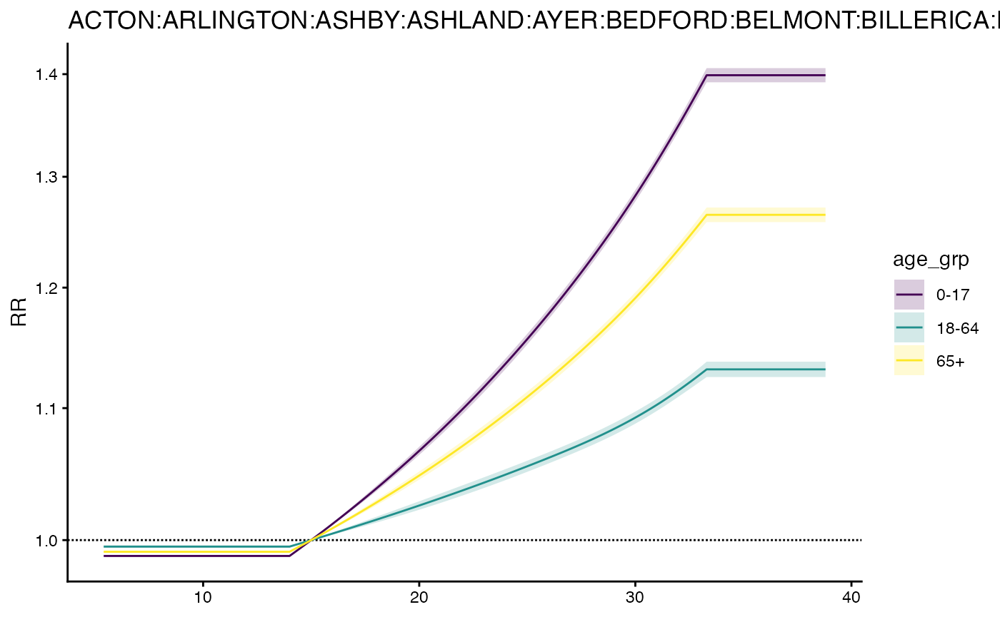
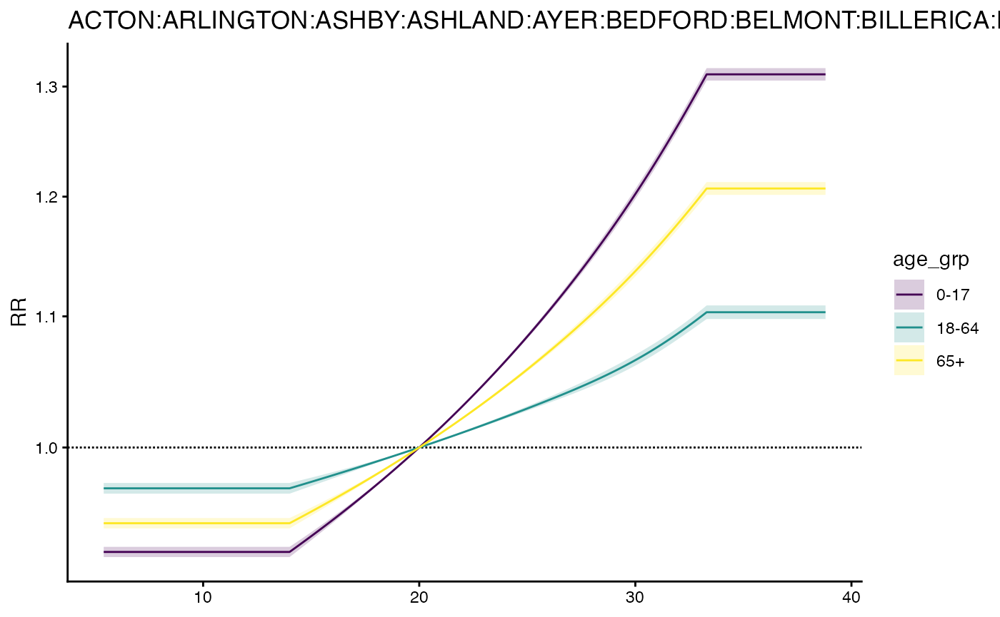

# One set of Heat-Health Associations for a single or multiple zones using \`cityClimateHealth\`

Let’s use built-in functions to examine a single set of beta
coefficients for heat-health relationships in a single or multiple
geographic unit. We’ll start with a review of DLNM, and then show how
its implemented in `cityClimateHealth` for both the single and
multi-zone cases.

For testing purposes, start with your largest geographic unit!

``` r

library(cityClimateHealth)
```

### Exposure data

First let’s make the exposure matrix for this single zone. There is a
**simulated** exposure dataset included in the package called
`ma_exposure`, which lists **daily maximum** temperatures each day in
each town.

``` r

boston_exposure <- subset(ma_exposure, TOWN20 == 'BOSTON')
head(boston_exposure)
#>             date tmax_C TOWN20 COUNTY20
#> 75121 2010-01-01   -0.4 BOSTON  SUFFOLK
#> 75122 2010-01-02    1.4 BOSTON  SUFFOLK
#> 75123 2010-01-03   -1.4 BOSTON  SUFFOLK
#> 75124 2010-01-04   -0.4 BOSTON  SUFFOLK
#> 75125 2010-01-05    0.7 BOSTON  SUFFOLK
#> 75126 2010-01-06    1.2 BOSTON  SUFFOLK
```

Notice how this dataset contains temperature for the whole year. This is
a good starting place.

Also notice that these data are messy, as is common in environmental
data, there are both NA values and days where there are no measurements:

``` r

# Sept 17 2010 has NA data
boston_exposure[255:260,]
#>             date tmax_C TOWN20 COUNTY20
#> 75375 2010-09-16   19.4 BOSTON  SUFFOLK
#> 75376 2010-09-17     NA BOSTON  SUFFOLK
#> 75377 2010-09-18   19.1 BOSTON  SUFFOLK
#> 75378 2010-09-19   19.6 BOSTON  SUFFOLK
#> 75379 2010-09-20   23.6 BOSTON  SUFFOLK
#> 75380 2010-09-21   20.8 BOSTON  SUFFOLK

# July 13 2010 is missing
boston_exposure[190:195,]
#>             date tmax_C TOWN20 COUNTY20
#> 75310 2010-07-12   31.7 BOSTON  SUFFOLK
#> 75311 2010-07-14   31.9 BOSTON  SUFFOLK
#> 75312 2010-07-15   23.7 BOSTON  SUFFOLK
#> 75313 2010-07-16   28.8 BOSTON  SUFFOLK
#> 75314 2010-07-17   33.3 BOSTON  SUFFOLK
#> 75315 2010-07-18   33.1 BOSTON  SUFFOLK
```

In the next step we’ll introduce a function which (a) cleans the data
and (b) subsets to just warm season months (which in Boston is May
through September). Its good to keep the full temperature range before
this point so we can use extra data around the cutoffs to make sure the
temperature matrix is full.

First, define the column mapping. The main geographic unit of analysis
(the `geo_unit`) is called `TOWN20`, however we may also want to
aggregate in some later steps to the group level, so the grouping
variable (`geo_unit_grp`) is called `COUNTY20`. Providing a named list
in this way avoids having to rename columns throughout the process.

``` r

exposure_columns <- list(
  "date" = "date",
  "exposure" = "tmax_C",
  "geo_unit" = "TOWN20",
  "geo_unit_grp" = "COUNTY20"
)
```

Next pass in your full temperature time-series in this step.

``` r

boston_exposure_mat <- make_exposure_matrix(boston_exposure, 
                                            exposure_columns,
                                            time_subset = list(month = 5:9))
#> -- NA values automatically removed
#> strata dt_by = 'day', setting strata as geo_unit:yr:mn:dow
head(boston_exposure_mat)
#>          date TOWN20 COUNTY20 tmax_C                   strata      match_strata
#>        <IDat> <char>   <char>  <num>                   <char>            <char>
#> 1: 2010-05-01 BOSTON  SUFFOLK   23.1 BOSTON:yr2010:mn05:dow07 BOSTON:2010-05-01
#> 2: 2010-05-02 BOSTON  SUFFOLK   26.1 BOSTON:yr2010:mn05:dow01 BOSTON:2010-05-02
#> 3: 2010-05-03 BOSTON  SUFFOLK   31.6 BOSTON:yr2010:mn05:dow02 BOSTON:2010-05-03
#> 4: 2010-05-04 BOSTON  SUFFOLK   27.8 BOSTON:yr2010:mn05:dow03 BOSTON:2010-05-04
#> 5: 2010-05-05 BOSTON  SUFFOLK   26.3 BOSTON:yr2010:mn05:dow04 BOSTON:2010-05-05
#> 6: 2010-05-06 BOSTON  SUFFOLK   25.9 BOSTON:yr2010:mn05:dow05 BOSTON:2010-05-06
#>    explag1 explag2 explag3 explag4 explag5
#>      <num>   <num>   <num>   <num>   <num>
#> 1:    15.7     8.3    10.9    16.4    18.7
#> 2:    23.1    15.7     8.3    10.9    16.4
#> 3:    26.1    23.1    15.7     8.3    10.9
#> 4:    31.6    26.1    23.1    15.7     8.3
#> 5:    27.8    31.6    26.1    23.1    15.7
#> 6:    26.3    27.8    31.6    26.1    23.1
```

You can check that the two problems we saw before – missing data and NA
data – are gone now

``` r

# Sept 17 2010 now has NA data
boston_exposure_mat[138:142,]
#>          date TOWN20 COUNTY20 tmax_C                   strata      match_strata
#>        <IDat> <char>   <char>  <num>                   <char>            <char>
#> 1: 2010-09-15 BOSTON  SUFFOLK  22.60 BOSTON:yr2010:mn09:dow04 BOSTON:2010-09-15
#> 2: 2010-09-16 BOSTON  SUFFOLK  19.40 BOSTON:yr2010:mn09:dow05 BOSTON:2010-09-16
#> 3: 2010-09-17 BOSTON  SUFFOLK  19.25 BOSTON:yr2010:mn09:dow06 BOSTON:2010-09-17
#> 4: 2010-09-18 BOSTON  SUFFOLK  19.10 BOSTON:yr2010:mn09:dow07 BOSTON:2010-09-18
#> 5: 2010-09-19 BOSTON  SUFFOLK  19.60 BOSTON:yr2010:mn09:dow01 BOSTON:2010-09-19
#>    explag1 explag2 explag3 explag4 explag5
#>      <num>   <num>   <num>   <num>   <num>
#> 1:   19.80   18.50    22.8    21.0    22.0
#> 2:   22.60   19.80    18.5    22.8    21.0
#> 3:   19.40   22.60    19.8    18.5    22.8
#> 4:   19.25   19.40    22.6    19.8    18.5
#> 5:   19.10   19.25    19.4    22.6    19.8

# July 13 2010 is now not missing
boston_exposure_mat[72:77,]
#>          date TOWN20 COUNTY20 tmax_C                   strata      match_strata
#>        <IDat> <char>   <char>  <num>                   <char>            <char>
#> 1: 2010-07-11 BOSTON  SUFFOLK   29.2 BOSTON:yr2010:mn07:dow01 BOSTON:2010-07-11
#> 2: 2010-07-12 BOSTON  SUFFOLK   31.7 BOSTON:yr2010:mn07:dow02 BOSTON:2010-07-12
#> 3: 2010-07-13 BOSTON  SUFFOLK   31.8 BOSTON:yr2010:mn07:dow03 BOSTON:2010-07-13
#> 4: 2010-07-14 BOSTON  SUFFOLK   31.9 BOSTON:yr2010:mn07:dow04 BOSTON:2010-07-14
#> 5: 2010-07-15 BOSTON  SUFFOLK   23.7 BOSTON:yr2010:mn07:dow05 BOSTON:2010-07-15
#> 6: 2010-07-16 BOSTON  SUFFOLK   28.8 BOSTON:yr2010:mn07:dow06 BOSTON:2010-07-16
#>    explag1 explag2 explag3 explag4 explag5
#>      <num>   <num>   <num>   <num>   <num>
#> 1:    33.1    32.8    34.6    37.2    36.2
#> 2:    29.2    33.1    32.8    34.6    37.2
#> 3:    31.7    29.2    33.1    32.8    34.6
#> 4:    31.8    31.7    29.2    33.1    32.8
#> 5:    31.9    31.8    31.7    29.2    33.1
#> 6:    23.7    31.9    31.8    31.7    29.2
```

Its probably a good idea to see if there is any systematic bias in the
missingness (i.e., are the data “missing at random”) but for the
purposes of this tutorial we’ll assume that they are (which is true
since these are simulated data!).

It may also be a good idea to check that the exposure values generally
look like you expect them to look (e.g., with some summary statistics),
just to make sure you don’t need to do anys additional pre-processing
(e.g., if there are location-specific wildly high or low temperatures,
this script as is will not catch those).

``` r

summary(boston_exposure_mat$tmax_C)
#>    Min. 1st Qu.  Median    Mean 3rd Qu.    Max. 
#>    8.00   22.20   26.20   25.48   29.00   38.70
```

For a time-series of daily maximum temperatures in warm-season months in
Boston MA, looks good!

### Outcome data

Next let’s investigate the deaths dataset - you can see that this has
town level daily deaths with by category for age group (0-17, 18-64, and
65+) as well as a binary-coded sex variable. Again, note that this data
is **simulated**.

``` r

boston_deaths   <- subset(ma_deaths, TOWN20 == 'BOSTON')
head(boston_deaths)
#>          date TOWN20 daily_deaths age_grp    sex COUNTY20
#>        <Date> <char>        <int>  <char> <char>   <char>
#> 1: 2010-05-01 BOSTON          385    0-17      M  SUFFOLK
#> 2: 2010-05-02 BOSTON          367    0-17      M  SUFFOLK
#> 3: 2010-05-03 BOSTON          431    0-17      M  SUFFOLK
#> 4: 2010-05-04 BOSTON          431    0-17      M  SUFFOLK
#> 5: 2010-05-05 BOSTON          456    0-17      M  SUFFOLK
#> 6: 2010-05-06 BOSTON          400    0-17      M  SUFFOLK
```

Starts with defining the outcome columns:

``` r

outcome_columns <- list(
  "date" = "date",
  "outcome" = "daily_deaths",
  "geo_unit" = "TOWN20",
  "geo_unit_grp" = "COUNTY20"
)
```

Notice that we have several columns of `factors` – right now we will sum
up within these groups, but we will introduce functionality later to run
models across multiple factors.

As with the exposure dataset, there may be some days that are missing
data, and we want to aggregate these data across the factors we aren’t
using and to the correct spatial unit for this analysis. The
`make_outcome_table` function accomplishes these goals,

``` r

boston_deaths_tbl <- make_outcome_table(boston_deaths,  outcome_columns,
                                        time_subset = list(month = 5:9))
#> Missing outcome values introduced by xgrid were set to 0;
#>             assumes that every time in the dataset should have an outcome value
#> strata dt_by = 'day', setting strata as geo_unit:yr:mn:dow
head(boston_deaths_tbl)
#>          date TOWN20 COUNTY20 daily_deaths                   strata
#>        <IDat> <char>   <char>        <int>                   <char>
#> 1: 2010-05-01 BOSTON  SUFFOLK         2238 BOSTON:yr2010:mn05:dow07
#> 2: 2010-05-02 BOSTON  SUFFOLK         2089 BOSTON:yr2010:mn05:dow01
#> 3: 2010-05-03 BOSTON  SUFFOLK         2374 BOSTON:yr2010:mn05:dow02
#> 4: 2010-05-04 BOSTON  SUFFOLK         2354 BOSTON:yr2010:mn05:dow03
#> 5: 2010-05-05 BOSTON  SUFFOLK         2489 BOSTON:yr2010:mn05:dow04
#> 6: 2010-05-06 BOSTON  SUFFOLK         2191 BOSTON:yr2010:mn05:dow05
#>    strata_total      match_strata
#>           <int>            <char>
#> 1:        11312 BOSTON:2010-05-01
#> 2:        10929 BOSTON:2010-05-02
#> 3:        11435 BOSTON:2010-05-03
#> 4:         9372 BOSTON:2010-05-04
#> 5:         9193 BOSTON:2010-05-05
#> 6:         8657 BOSTON:2010-05-06
```

Notice that two variables have been added:

1.  the `strata`. typically this is for for geo-unit (or geo-unit-grp),
    year, month- and day of week (essential for a time- and- space
    stratified conditional poisson model of heat-heath impacts). If
    `geo-unit`, then results are estimated at the `geo-unit` level. if
    `geo-unit-grp`, then results are estimated at the `geo-unit-grp`
    level.

and (2) a variable `strata_total` describing the number of total
outcomes within each strata

### Basic DLNM (manual walkthrough)

Now, we’ll walk through a basic DLNM of heat-health associations for a
single zone. This assumes some basic knowledge of
[`library(dlnm)`](https://github.com/gasparrini/dlnm).

Here are the libraries we’ll need to run a conditional poisson model.

``` r

library(dlnm)
library(gnm)
library(ggplot2)
library(data.table)
```

Here are the inputs to define the crossbasis matrix. We use a default of
`ns` so that the behavior at the the tails of the distribution is
linear.

``` r

arg_fun = 'ns'
lag_fun = 'ns'
x_knots = quantile(boston_exposure_mat$tmax_C, probs = c(0.5, 0.9))
maxlag = 5
nk = 2
```

And put these into the lists for `argvar` and `arglag`:

``` r

argvar <- list(fun = arg_fun, knots = x_knots)
arglag <- list(fun = lag_fun, knots = logknots(maxlag, nk = nk))
```

Limit the columns of the exposure matrix to be just the ones up to
`maxlag`:

``` r

xcols <- c('tmax_C', paste0('explag',1:maxlag))
x_mat <- boston_exposure_mat[, ..xcols]

cb <- crossbasis(x_mat, lag = maxlag, argvar = argvar, arglag = arglag)
```

Now run the model

``` r

m_sub <- gnm(daily_deaths ~ cb,
             data = boston_deaths_tbl,
             family = quasipoisson,
             eliminate = factor(strata),
             subset = strata_total > 0)
summary(m_sub)
#> 
#> Call:
#> gnm(formula = daily_deaths ~ cb, eliminate = factor(strata), 
#>     family = quasipoisson, data = boston_deaths_tbl, subset = strata_total > 
#>         0)
#> 
#> Deviance Residuals: 
#>      Min        1Q    Median        3Q       Max  
#> -4.01375  -1.24434   0.02461   1.28224   4.31338  
#> 
#> Coefficients of interest:
#>           Estimate Std. Error t value Pr(>|t|)    
#> cbv1.l1  0.0109784  0.0164413   0.668  0.50453    
#> cbv1.l2  0.0006729  0.0149994   0.045  0.96423    
#> cbv1.l3  0.1163359  0.0090989  12.786  < 2e-16 ***
#> cbv1.l4 -0.0534439  0.0090748  -5.889 6.04e-09 ***
#> cbv2.l1  0.0672159  0.0527738   1.274  0.20321    
#> cbv2.l2  0.0180828  0.0491205   0.368  0.71289    
#> cbv2.l3  0.2108521  0.0327248   6.443 2.18e-10 ***
#> cbv2.l4 -0.0986866  0.0330841  -2.983  0.00296 ** 
#> cbv3.l1  0.0862389  0.0356515   2.419  0.01582 *  
#> cbv3.l2 -0.0170908  0.0314134  -0.544  0.58657    
#> cbv3.l3  0.1735069  0.0211209   8.215  < 2e-16 ***
#> cbv3.l4 -0.0855985  0.0202383  -4.230 2.65e-05 ***
#> ---
#> Signif. codes:  0 '***' 0.001 '**' 0.01 '*' 0.05 '.' 0.1 ' ' 1
#> 
#> (Dispersion parameter for quasipoisson family taken to be 3.753814)
#> 
#> Residual deviance: 2614.7 on 696 degrees of freedom
#> AIC: NA
#> 
#> Number of iterations: 2
```

Notice that the dispersion parameter is quite high! but again, these are
simulated data – this is part of how the quasipoisson model works and is
used to re-scale the variance covariance matrix.

Next get the crosspred outputs correctly centered at the minimum RR

``` r

cp <- crosspred(cb, m_sub, cen = 20, by = 0.1)

cen = cp$predvar[which.min(cp$allRRfit)]

cp <- crosspred(cb, m_sub, cen = cen, by = 0.1)
```

And plot

``` r

plot_cp = data.frame(
    x = cp$predvar,
    RR = cp$allRRfit,
    RRlb = cp$allRRlow,
    RRhigh = cp$allRRhigh
)

ggplot(plot_cp, aes(x = x, y = RR, ymin = RRlb, ymax = RRhigh)) +
  geom_hline(yintercept = 1, linetype = '11') +
  theme_classic() +
  geom_ribbon(fill = 'grey75', alpha = 0.2) +
  geom_line() + xlab("Tmax (degC)")
```



Finally, do some basic checks of the math using other utility functions
to estimate the dispersion parameters and the variance-covariance
matrix. Both of these functions will be useful once we are no longer
using R functions to estimate the model.

First to check the dispersion

``` r

dispersion <- calc_dispersion(y = boston_deaths_tbl$daily_deaths, 
                X = cb, 
                stratum_vector = boston_deaths_tbl$strata, 
                beta = coef(m_sub))
dispersion
#> [1] 3.753814
```

Next to check vcov

``` r

vcov_beta <- calc_vcov(y = boston_deaths_tbl$daily_deaths, 
                X = cb, 
                stratum_vector = boston_deaths_tbl$strata, 
                beta = coef(m_sub))

# update with the dipserion parameter
t1 <- vcov_beta * dispersion

# check against the original model's vcov
t2 <- vcov(m_sub)
attributes(t2) <- NULL
t2 <- matrix(t2, nrow = nrow(t1), ncol = ncol(t1))

# should be the same
all.equal(t1, t2, tolerance = 1e-8)
#> [1] TRUE
```

### Basic DLNM (using `cityClimateHealth` functions in `R`)

The functionality above is what is encapsulated in the `condPois_1stage`
function. This is one of the chief innovations of this package. Starting
from a messy exposure and outcome dataset, we can quickly estimate
heat-health impacts in 3 lines.

We have built-in defaults for `argvar`, `arglag`, and `maxlag` for the
investigation of warm-season non-fatal health impacts associated with
increases in temperature. We don’t need to check the dispersion
parameter here since this is using `gnm` under the hood.

``` r

# create exposure matrix
exposure_columns <- list(
  "date" = "date",
  "exposure" = "tmax_C",
  "geo_unit" = "TOWN20",
  "geo_unit_grp" = "COUNTY20"
)
boston_exposure_mat <- make_exposure_matrix(boston_exposure, exposure_columns,
                                            time_subset = list(month = 5:9))
#> -- NA values automatically removed
#> strata dt_by = 'day', setting strata as geo_unit:yr:mn:dow

# create outcome table
outcome_columns <- list(
  "date" = "date",
  "outcome" = "daily_deaths",
  "geo_unit" = "TOWN20",
  "geo_unit_grp" = "COUNTY20"
)
boston_deaths_tbl <- make_outcome_table(boston_deaths,  outcome_columns,
                                        time_subset = list(month = 5:9))
#> Missing outcome values introduced by xgrid were set to 0;
#>             assumes that every time in the dataset should have an outcome value
#> strata dt_by = 'day', setting strata as geo_unit:yr:mn:dow

# run the model
m1 <- condPois_1stage(exposure_matrix = boston_exposure_mat, 
                  outcomes_tbl = boston_deaths_tbl)
#> 
#> crossbasis args for geo_unit  BOSTON :
#> 
#> maxlag: 5 
#> 
#> argvar:
#> List of 2
#>  $ fun  : chr "ns"
#>  $ knots: Named num [1:2] 26.2 31.7
#>   ..- attr(*, "names")= chr [1:2] "50%" "90%"
#> 
#> arglag:
#> List of 2
#>  $ fun  : chr "ns"
#>  $ knots: num [1:2] 0.878 2.095
#> 
#> strata:
#> BOSTON:yr2010:mn05:dow07
#> strata_min: 0 
#> 
#> min_n: 50 
#> 
#> truncate final RR and basis cen:  0.025 
#> formula:
#>    daily_deaths ~ cb
#> family: quasipoisson
#> Warning in condPois_1stage(exposure_matrix = boston_exposure_mat, outcomes_tbl = boston_deaths_tbl): Centering point is outside the range of exposures in geo-unit BOSTON: Cen = 6.80, x_b = (8.00, 39.00).
#>         This means your zones are across too large of an area, or if exposure is factor there could
#>         be too few events in this area, or
#>         there are differences in exposures so much that the bases are quite different. Try limiting the geo-units passed in to those that are more similar, manually setting a centering point that you know each geo-unit has, or changing your exposure variable.
```

And plot the relative risk

``` r

plot(m1)
```

 The truncation
is controlled by the `truncate` argument in model calls, which can range
from 0 to 0.05, which indicates the percentile cutoffs.

You can also plots the lags:

``` r

plot_lag(m1, exposure_val = 33)
```



You can also get the RR table for your own usage

``` r

getRR(m1)
#>      tmax_C       RR     RRlb     RRub n_geo_names     model_class
#>       <num>    <num>    <num>    <num>      <char>          <char>
#>   1:    6.8 1.050388 1.025204 1.076192      BOSTON condPois_1stage
#>   2:    6.9 1.050388 1.025204 1.076192      BOSTON condPois_1stage
#>   3:    7.0 1.050388 1.025204 1.076192      BOSTON condPois_1stage
#>   4:    7.1 1.050388 1.025204 1.076192      BOSTON condPois_1stage
#>   5:    7.2 1.050388 1.025204 1.076192      BOSTON condPois_1stage
#>  ---                                                              
#> 316:   38.3 1.336936 1.285904 1.389993      BOSTON condPois_1stage
#> 317:   38.4 1.336936 1.285904 1.389993      BOSTON condPois_1stage
#> 318:   38.5 1.336936 1.285904 1.389993      BOSTON condPois_1stage
#> 319:   38.6 1.336936 1.285904 1.389993      BOSTON condPois_1stage
#> 320:   38.7 1.336936 1.285904 1.389993      BOSTON condPois_1stage
```

### Multi-zone DLNM

You can also easily extend to a 1 stage multi-zone case. You don’t need
to include population offset because within the geo_unit:year:month:dow
strata the populations don’t change (one of the benefits of the
conditional poisson setup – you would need to include a population
offset if you were doing a time-series design).

``` r

# create exposure matrix
exposure_columns <- list(
  "date" = "date",
  "exposure" = "tmax_C",
  "geo_unit" = "TOWN20",
  "geo_unit_grp" = "COUNTY20"
)
middlesex_exposure <- subset(ma_exposure, COUNTY20 == 'MIDDLESEX')
middlesex_exposure_mat <- make_exposure_matrix(middlesex_exposure, exposure_columns,
                                               time_subset = list(month = 5:9))
#> -- NA values automatically removed
#> strata dt_by = 'day', setting strata as geo_unit:yr:mn:dow

# create outcome table
outcome_columns <- list(
  "date" = "date",
  "outcome" = "daily_deaths",
  "geo_unit" = "TOWN20",
  "geo_unit_grp" = "COUNTY20"
)
middlesex_deaths   <- subset(ma_deaths, COUNTY20 == 'MIDDLESEX')
middlesex_deaths_tbl <- make_outcome_table(middlesex_deaths,  outcome_columns,
                                           time_subset = list(month = 5:9))
#> Missing outcome values introduced by xgrid were set to 0;
#>             assumes that every time in the dataset should have an outcome value
#> strata dt_by = 'day', setting strata as geo_unit:yr:mn:dow

# run the model
m2 <- condPois_1stage(exposure_matrix = middlesex_exposure_mat, 
                  outcomes_tbl = middlesex_deaths_tbl, multi_zone = TRUE,
                  global_cen = 15)
#> 
#> crossbasis args for geo_unit  ACTON,ARLINGTON,ASHBY,ASHLAND,AYER,BEDFORD,BELMONT,BILLERICA,BOXBOROUGH,BURLINGTON,CAMBRIDGE,CARLISLE,CHELMSFORD,CONCORD,DRACUT,DUNSTABLE,EVERETT,FRAMINGHAM,GROTON,HOLLISTON,HOPKINTON,HUDSON,LEXINGTON,LINCOLN,LITTLETON,LOWELL,MALDEN,MARLBOROUGH,MAYNARD,MEDFORD,MELROSE,NATICK,NEWTON,NORTH READING,PEPPERELL,READING,SHERBORN,SHIRLEY,SOMERVILLE,STONEHAM,STOW,SUDBURY,TEWKSBURY,TOWNSEND,TYNGSBOROUGH,WAKEFIELD,WALTHAM,WATERTOWN,WAYLAND,WESTFORD,WESTON,WILMINGTON,WINCHESTER,WOBURN :
#> 
#> maxlag: 5 
#> 
#> argvar:
#> List of 2
#>  $ fun  : chr "ns"
#>  $ knots: Named num [1:2] 25.8 31
#>   ..- attr(*, "names")= chr [1:2] "50%" "90%"
#> 
#> arglag:
#> List of 2
#>  $ fun  : chr "ns"
#>  $ knots: num [1:2] 0.878 2.095
#> 
#> strata:
#> ACTON:yr2010:mn05:dow07
#> strata_min: 0 
#> 
#> min_n: 50 
#> 
#> truncate final RR and basis cen:  0.025 
#> formula:
#>    daily_deaths ~ cb
#> family: quasipoisson
```

And plot - notice the tighter confidence interval

``` r

plot(m2)
```



And get RR

``` r

getRR(m2)
#>      tmax_C        RR      RRlb      RRub                   n_geo_names
#>       <num>     <num>     <num>     <num>                        <char>
#>   1:    5.4 0.9918277 0.9911066 0.9925493 ACTON:ARLINGTON...(truncated)
#>   2:    5.5 0.9918277 0.9911066 0.9925493 ACTON:ARLINGTON...(truncated)
#>   3:    5.6 0.9918277 0.9911066 0.9925493 ACTON:ARLINGTON...(truncated)
#>   4:    5.7 0.9918277 0.9911066 0.9925493 ACTON:ARLINGTON...(truncated)
#>   5:    5.8 0.9918277 0.9911066 0.9925493 ACTON:ARLINGTON...(truncated)
#>  ---                                                                   
#> 331:   38.4 1.2660451 1.2600603 1.2720583 ACTON:ARLINGTON...(truncated)
#> 332:   38.5 1.2660451 1.2600603 1.2720583 ACTON:ARLINGTON...(truncated)
#> 333:   38.6 1.2660451 1.2600603 1.2720583 ACTON:ARLINGTON...(truncated)
#> 334:   38.7 1.2660451 1.2600603 1.2720583 ACTON:ARLINGTON...(truncated)
#> 335:   38.8 1.2660451 1.2600603 1.2720583 ACTON:ARLINGTON...(truncated)
#>          model_class
#>               <char>
#>   1: condPois_1stage
#>   2: condPois_1stage
#>   3: condPois_1stage
#>   4: condPois_1stage
#>   5: condPois_1stage
#>  ---                
#> 331: condPois_1stage
#> 332: condPois_1stage
#> 333: condPois_1stage
#> 334: condPois_1stage
#> 335: condPois_1stage
```

### Multi-factor single beta coeff

you can also get it for factors

``` r

outcome_columns <- list(
  "date" = "date",
  "outcome" = "daily_deaths",
  "factor" = "age_grp",
  "geo_unit" = "TOWN20",
  "geo_unit_grp" = "COUNTY20"
)
middlesex_deaths_tbl <- make_outcome_table(
  middlesex_deaths,  outcome_columns, time_subset = list(month = 5:9))
#> > Combined factor is  age_grp
#> Missing outcome values introduced by xgrid were set to 0;
#>             assumes that every time in the dataset should have an outcome value
#> strata dt_by = 'day', setting strata as geo_unit:yr:mn:dow

# run the model
m3 <- condPois_1stage(exposure_matrix = middlesex_exposure_mat, 
                  outcomes_tbl = middlesex_deaths_tbl, 
                  global_cen = 15,
                  multi_zone = TRUE,
                  verbose = 1)
#> < age_grp : 0-17 >
#> 
#> crossbasis args for geo_unit  ACTON,ARLINGTON,ASHBY,ASHLAND,AYER,BEDFORD,BELMONT,BILLERICA,BOXBOROUGH,BURLINGTON,CAMBRIDGE,CARLISLE,CHELMSFORD,CONCORD,DRACUT,DUNSTABLE,EVERETT,FRAMINGHAM,GROTON,HOLLISTON,HOPKINTON,HUDSON,LEXINGTON,LINCOLN,LITTLETON,LOWELL,MALDEN,MARLBOROUGH,MAYNARD,MEDFORD,MELROSE,NATICK,NEWTON,NORTH READING,PEPPERELL,READING,SHERBORN,SHIRLEY,SOMERVILLE,STONEHAM,STOW,SUDBURY,TEWKSBURY,TOWNSEND,TYNGSBOROUGH,WAKEFIELD,WALTHAM,WATERTOWN,WAYLAND,WESTFORD,WESTON,WILMINGTON,WINCHESTER,WOBURN :
#> 
#> maxlag: 5 
#> 
#> argvar:
#> List of 2
#>  $ fun  : chr "ns"
#>  $ knots: Named num [1:2] 25.8 31
#>   ..- attr(*, "names")= chr [1:2] "50%" "90%"
#> 
#> arglag:
#> List of 2
#>  $ fun  : chr "ns"
#>  $ knots: num [1:2] 0.878 2.095
#> 
#> strata:
#> ACTON:yr2010:mn05:dow07
#> strata_min: 0 
#> 
#> min_n: 50 
#> 
#> truncate final RR and basis cen:  0.025 
#> formula:
#>    daily_deaths ~ cb
#> family: quasipoisson
#> < age_grp : 18-64 >
#> 
#> crossbasis args for geo_unit  ACTON,ARLINGTON,ASHBY,ASHLAND,AYER,BEDFORD,BELMONT,BILLERICA,BOXBOROUGH,BURLINGTON,CAMBRIDGE,CARLISLE,CHELMSFORD,CONCORD,DRACUT,DUNSTABLE,EVERETT,FRAMINGHAM,GROTON,HOLLISTON,HOPKINTON,HUDSON,LEXINGTON,LINCOLN,LITTLETON,LOWELL,MALDEN,MARLBOROUGH,MAYNARD,MEDFORD,MELROSE,NATICK,NEWTON,NORTH READING,PEPPERELL,READING,SHERBORN,SHIRLEY,SOMERVILLE,STONEHAM,STOW,SUDBURY,TEWKSBURY,TOWNSEND,TYNGSBOROUGH,WAKEFIELD,WALTHAM,WATERTOWN,WAYLAND,WESTFORD,WESTON,WILMINGTON,WINCHESTER,WOBURN :
#> 
#> maxlag: 5 
#> 
#> argvar:
#> List of 2
#>  $ fun  : chr "ns"
#>  $ knots: Named num [1:2] 25.8 31
#>   ..- attr(*, "names")= chr [1:2] "50%" "90%"
#> 
#> arglag:
#> List of 2
#>  $ fun  : chr "ns"
#>  $ knots: num [1:2] 0.878 2.095
#> 
#> strata:
#> ACTON:yr2010:mn05:dow07
#> strata_min: 0 
#> 
#> min_n: 50 
#> 
#> truncate final RR and basis cen:  0.025 
#> formula:
#>    daily_deaths ~ cb
#> family: quasipoisson
#> < age_grp : 65+ >
#> 
#> crossbasis args for geo_unit  ACTON,ARLINGTON,ASHBY,ASHLAND,AYER,BEDFORD,BELMONT,BILLERICA,BOXBOROUGH,BURLINGTON,CAMBRIDGE,CARLISLE,CHELMSFORD,CONCORD,DRACUT,DUNSTABLE,EVERETT,FRAMINGHAM,GROTON,HOLLISTON,HOPKINTON,HUDSON,LEXINGTON,LINCOLN,LITTLETON,LOWELL,MALDEN,MARLBOROUGH,MAYNARD,MEDFORD,MELROSE,NATICK,NEWTON,NORTH READING,PEPPERELL,READING,SHERBORN,SHIRLEY,SOMERVILLE,STONEHAM,STOW,SUDBURY,TEWKSBURY,TOWNSEND,TYNGSBOROUGH,WAKEFIELD,WALTHAM,WATERTOWN,WAYLAND,WESTFORD,WESTON,WILMINGTON,WINCHESTER,WOBURN :
#> 
#> maxlag: 5 
#> 
#> argvar:
#> List of 2
#>  $ fun  : chr "ns"
#>  $ knots: Named num [1:2] 25.8 31
#>   ..- attr(*, "names")= chr [1:2] "50%" "90%"
#> 
#> arglag:
#> List of 2
#>  $ fun  : chr "ns"
#>  $ knots: num [1:2] 0.878 2.095
#> 
#> strata:
#> ACTON:yr2010:mn05:dow07
#> strata_min: 0 
#> 
#> min_n: 50 
#> 
#> truncate final RR and basis cen:  0.025 
#> formula:
#>    daily_deaths ~ cb
#> family: quasipoisson

# plot
plot(m3)
```



And get RR

``` r

getRR(m3)
#>       tmax_C age_grp                   n_geo_names        RR      RRlb
#>        <num>  <char>                        <char>     <num>     <num>
#>    1:    5.4    0-17 ACTON:ARLINGTON...(truncated) 0.9886238 0.9878368
#>    2:    5.5    0-17 ACTON:ARLINGTON...(truncated) 0.9886238 0.9878368
#>    3:    5.6    0-17 ACTON:ARLINGTON...(truncated) 0.9886238 0.9878368
#>    4:    5.7    0-17 ACTON:ARLINGTON...(truncated) 0.9886238 0.9878368
#>    5:    5.8    0-17 ACTON:ARLINGTON...(truncated) 0.9886238 0.9878368
#>   ---                                                                 
#> 1001:   38.4     65+ ACTON:ARLINGTON...(truncated) 1.2647692 1.2581256
#> 1002:   38.5     65+ ACTON:ARLINGTON...(truncated) 1.2647692 1.2581256
#> 1003:   38.6     65+ ACTON:ARLINGTON...(truncated) 1.2647692 1.2581256
#> 1004:   38.7     65+ ACTON:ARLINGTON...(truncated) 1.2647692 1.2581256
#> 1005:   38.8     65+ ACTON:ARLINGTON...(truncated) 1.2647692 1.2581256
#>            RRub          model_class
#>           <num>               <char>
#>    1: 0.9894114 condPois_1stage_list
#>    2: 0.9894114 condPois_1stage_list
#>    3: 0.9894114 condPois_1stage_list
#>    4: 0.9894114 condPois_1stage_list
#>    5: 0.9894114 condPois_1stage_list
#>   ---                               
#> 1001: 1.2714479 condPois_1stage_list
#> 1002: 1.2714479 condPois_1stage_list
#> 1003: 1.2714479 condPois_1stage_list
#> 1004: 1.2714479 condPois_1stage_list
#> 1005: 1.2714479 condPois_1stage_list
```

### Changing the global_cen

You can change the global_cen and view the impact.

``` r

# run the model
m2 <- condPois_1stage(exposure_matrix = middlesex_exposure_mat, global_cen = 20, outcomes_tbl = middlesex_deaths_tbl, multi_zone = TRUE, verbose = 1)
#> < age_grp : 0-17 >
#> 
#> crossbasis args for geo_unit  ACTON,ARLINGTON,ASHBY,ASHLAND,AYER,BEDFORD,BELMONT,BILLERICA,BOXBOROUGH,BURLINGTON,CAMBRIDGE,CARLISLE,CHELMSFORD,CONCORD,DRACUT,DUNSTABLE,EVERETT,FRAMINGHAM,GROTON,HOLLISTON,HOPKINTON,HUDSON,LEXINGTON,LINCOLN,LITTLETON,LOWELL,MALDEN,MARLBOROUGH,MAYNARD,MEDFORD,MELROSE,NATICK,NEWTON,NORTH READING,PEPPERELL,READING,SHERBORN,SHIRLEY,SOMERVILLE,STONEHAM,STOW,SUDBURY,TEWKSBURY,TOWNSEND,TYNGSBOROUGH,WAKEFIELD,WALTHAM,WATERTOWN,WAYLAND,WESTFORD,WESTON,WILMINGTON,WINCHESTER,WOBURN :
#> 
#> maxlag: 5 
#> 
#> argvar:
#> List of 2
#>  $ fun  : chr "ns"
#>  $ knots: Named num [1:2] 25.8 31
#>   ..- attr(*, "names")= chr [1:2] "50%" "90%"
#> 
#> arglag:
#> List of 2
#>  $ fun  : chr "ns"
#>  $ knots: num [1:2] 0.878 2.095
#> 
#> strata:
#> ACTON:yr2010:mn05:dow07
#> strata_min: 0 
#> 
#> min_n: 50 
#> 
#> truncate final RR and basis cen:  0.025 
#> formula:
#>    daily_deaths ~ cb
#> family: quasipoisson
#> < age_grp : 18-64 >
#> 
#> crossbasis args for geo_unit  ACTON,ARLINGTON,ASHBY,ASHLAND,AYER,BEDFORD,BELMONT,BILLERICA,BOXBOROUGH,BURLINGTON,CAMBRIDGE,CARLISLE,CHELMSFORD,CONCORD,DRACUT,DUNSTABLE,EVERETT,FRAMINGHAM,GROTON,HOLLISTON,HOPKINTON,HUDSON,LEXINGTON,LINCOLN,LITTLETON,LOWELL,MALDEN,MARLBOROUGH,MAYNARD,MEDFORD,MELROSE,NATICK,NEWTON,NORTH READING,PEPPERELL,READING,SHERBORN,SHIRLEY,SOMERVILLE,STONEHAM,STOW,SUDBURY,TEWKSBURY,TOWNSEND,TYNGSBOROUGH,WAKEFIELD,WALTHAM,WATERTOWN,WAYLAND,WESTFORD,WESTON,WILMINGTON,WINCHESTER,WOBURN :
#> 
#> maxlag: 5 
#> 
#> argvar:
#> List of 2
#>  $ fun  : chr "ns"
#>  $ knots: Named num [1:2] 25.8 31
#>   ..- attr(*, "names")= chr [1:2] "50%" "90%"
#> 
#> arglag:
#> List of 2
#>  $ fun  : chr "ns"
#>  $ knots: num [1:2] 0.878 2.095
#> 
#> strata:
#> ACTON:yr2010:mn05:dow07
#> strata_min: 0 
#> 
#> min_n: 50 
#> 
#> truncate final RR and basis cen:  0.025 
#> formula:
#>    daily_deaths ~ cb
#> family: quasipoisson
#> < age_grp : 65+ >
#> 
#> crossbasis args for geo_unit  ACTON,ARLINGTON,ASHBY,ASHLAND,AYER,BEDFORD,BELMONT,BILLERICA,BOXBOROUGH,BURLINGTON,CAMBRIDGE,CARLISLE,CHELMSFORD,CONCORD,DRACUT,DUNSTABLE,EVERETT,FRAMINGHAM,GROTON,HOLLISTON,HOPKINTON,HUDSON,LEXINGTON,LINCOLN,LITTLETON,LOWELL,MALDEN,MARLBOROUGH,MAYNARD,MEDFORD,MELROSE,NATICK,NEWTON,NORTH READING,PEPPERELL,READING,SHERBORN,SHIRLEY,SOMERVILLE,STONEHAM,STOW,SUDBURY,TEWKSBURY,TOWNSEND,TYNGSBOROUGH,WAKEFIELD,WALTHAM,WATERTOWN,WAYLAND,WESTFORD,WESTON,WILMINGTON,WINCHESTER,WOBURN :
#> 
#> maxlag: 5 
#> 
#> argvar:
#> List of 2
#>  $ fun  : chr "ns"
#>  $ knots: Named num [1:2] 25.8 31
#>   ..- attr(*, "names")= chr [1:2] "50%" "90%"
#> 
#> arglag:
#> List of 2
#>  $ fun  : chr "ns"
#>  $ knots: num [1:2] 0.878 2.095
#> 
#> strata:
#> ACTON:yr2010:mn05:dow07
#> strata_min: 0 
#> 
#> min_n: 50 
#> 
#> truncate final RR and basis cen:  0.025 
#> formula:
#>    daily_deaths ~ cb
#> family: quasipoisson
plot(m2)
```



Note that global_cen must be within the range of exposures. Otherwise,
the model is invalid and will not run.
