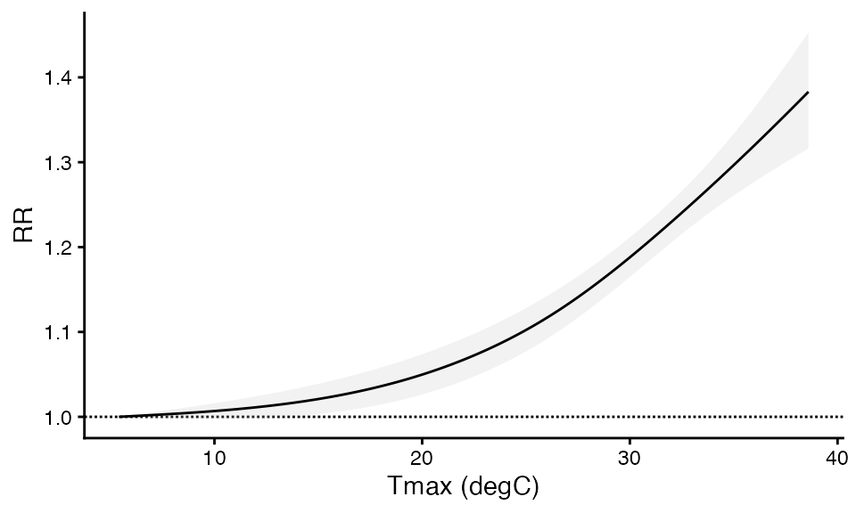
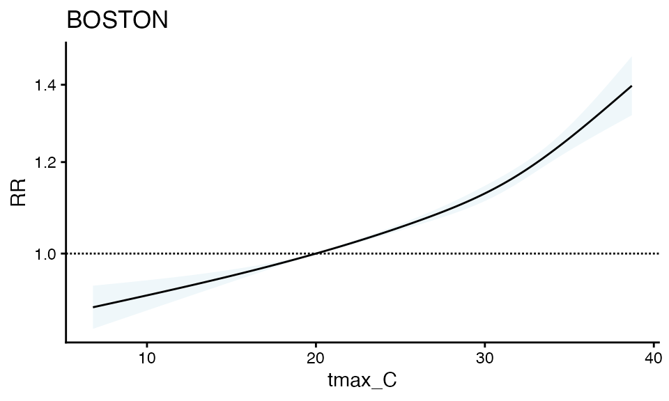
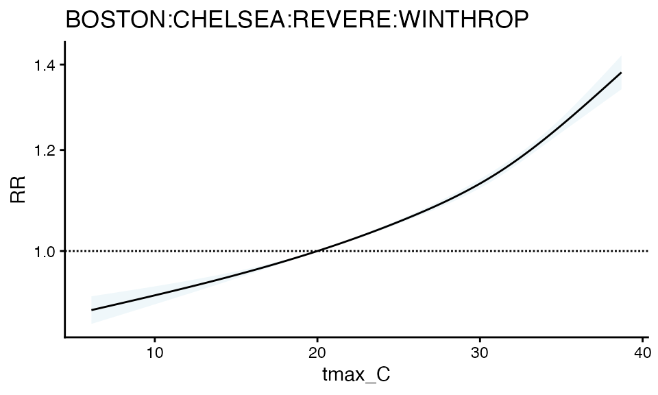

# one_stage_time_series_demo

``` r

library(cityClimateHealth)
```

### Time-Series Analysis and CityClimateHealth

Let’s use built-in functions to examine a single set of beta
coefficients for heat-health relationships in a single or multiple
geographic unit. We’ll start with a review of DLNM, and then show how
it’s implemented with time-series analysis in `cityClimateHealth` for
both the single and multi-zone cases.

For testing purposes, start with your largest geographic unit!

``` r

library(cityClimateHealth)
```

### Exposure data

First let’s make the exposure matrix for this single zone. There is a
**simulated** exposure dataset included in the package called
`ma_exposure`, which lists **daily maximum** temperatures each day in
each town. Let’s take a look at the available data:

``` r

head(ma_exposure)
#>         date tmax_C   TOWN20 COUNTY20
#> 1 2010-01-01   -1.6 ABINGTON PLYMOUTH
#> 2 2010-01-02    2.0 ABINGTON PLYMOUTH
#> 3 2010-01-03   -1.2 ABINGTON PLYMOUTH
#> 4 2010-01-04   -6.4 ABINGTON PLYMOUTH
#> 5 2010-01-05   -1.8 ABINGTON PLYMOUTH
#> 6 2010-01-06   -3.3 ABINGTON PLYMOUTH
```

Notice how this dataset contains temperature for the whole year. This is
a good starting place.

Now, we’ll subset to just Boston, to start with a single-zone example.

``` r

boston_exposure <- subset(ma_exposure, TOWN20 == 'BOSTON')
head(boston_exposure)
#>             date tmax_C TOWN20 COUNTY20
#> 75121 2010-01-01   -0.4 BOSTON  SUFFOLK
#> 75122 2010-01-02    1.4 BOSTON  SUFFOLK
#> 75123 2010-01-03   -1.4 BOSTON  SUFFOLK
#> 75124 2010-01-04   -0.4 BOSTON  SUFFOLK
#> 75125 2010-01-05    0.7 BOSTON  SUFFOLK
#> 75126 2010-01-06    1.2 BOSTON  SUFFOLK
```

Also notice that these data are messy, as is common in environmental
data, there are both NA values and days where there are no measurements:

``` r

# Sept 17 2010 has NA data
boston_exposure[255:260,]
#>             date tmax_C TOWN20 COUNTY20
#> 75375 2010-09-16   19.4 BOSTON  SUFFOLK
#> 75376 2010-09-17     NA BOSTON  SUFFOLK
#> 75377 2010-09-18   19.1 BOSTON  SUFFOLK
#> 75378 2010-09-19   19.6 BOSTON  SUFFOLK
#> 75379 2010-09-20   23.6 BOSTON  SUFFOLK
#> 75380 2010-09-21   20.8 BOSTON  SUFFOLK

# July 13 2010 is missing
boston_exposure[190:195,]
#>             date tmax_C TOWN20 COUNTY20
#> 75310 2010-07-12   31.7 BOSTON  SUFFOLK
#> 75311 2010-07-14   31.9 BOSTON  SUFFOLK
#> 75312 2010-07-15   23.7 BOSTON  SUFFOLK
#> 75313 2010-07-16   28.8 BOSTON  SUFFOLK
#> 75314 2010-07-17   33.3 BOSTON  SUFFOLK
#> 75315 2010-07-18   33.1 BOSTON  SUFFOLK
```

In the next step we’ll introduce a function which (a) cleans the data
and (b) subsets to just warm season months (which in Boston is May
through September). It’s good to keep the full temperature range before
this point so we can use extra data around the cutoffs to make sure the
temperature matrix is full.

First, define the column mapping. The main geographic unit of analysis
(the `geo_unit`) is called `TOWN20`, however we may also want to
aggregate in some later steps to the group level, so the grouping
variable (`geo_unit_grp`) is called `COUNTY20`. Providing a named list
in this way avoids having to rename columns throughout the process.

``` r

exposure_columns <- list(
  "date" = "date",
  "exposure" = "tmax_C",
  "geo_unit" = "TOWN20",
  "geo_unit_grp" = "COUNTY20"
)
```

Next pass in your full temperature time-series in this step.

``` r

boston_exposure_mat <- make_exposure_matrix(boston_exposure, 
                                            exposure_columns,
                                            time_subset = list(month = 5:9))
#> -- NA values automatically removed
#> strata dt_by = 'day', setting strata as geo_unit:yr:mn:dow
head(boston_exposure_mat)
#>          date TOWN20 COUNTY20 tmax_C                   strata      match_strata
#>        <IDat> <char>   <char>  <num>                   <char>            <char>
#> 1: 2010-05-01 BOSTON  SUFFOLK   23.1 BOSTON:yr2010:mn05:dow07 BOSTON:2010-05-01
#> 2: 2010-05-02 BOSTON  SUFFOLK   26.1 BOSTON:yr2010:mn05:dow01 BOSTON:2010-05-02
#> 3: 2010-05-03 BOSTON  SUFFOLK   31.6 BOSTON:yr2010:mn05:dow02 BOSTON:2010-05-03
#> 4: 2010-05-04 BOSTON  SUFFOLK   27.8 BOSTON:yr2010:mn05:dow03 BOSTON:2010-05-04
#> 5: 2010-05-05 BOSTON  SUFFOLK   26.3 BOSTON:yr2010:mn05:dow04 BOSTON:2010-05-05
#> 6: 2010-05-06 BOSTON  SUFFOLK   25.9 BOSTON:yr2010:mn05:dow05 BOSTON:2010-05-06
#>    explag1 explag2 explag3 explag4 explag5
#>      <num>   <num>   <num>   <num>   <num>
#> 1:    15.7     8.3    10.9    16.4    18.7
#> 2:    23.1    15.7     8.3    10.9    16.4
#> 3:    26.1    23.1    15.7     8.3    10.9
#> 4:    31.6    26.1    23.1    15.7     8.3
#> 5:    27.8    31.6    26.1    23.1    15.7
#> 6:    26.3    27.8    31.6    26.1    23.1
```

You can check that the two problems we saw before – missing data and NA
data – are gone now

``` r

# Sept 17 2010 now has no NA data
boston_exposure_mat[138:142,]
#>          date TOWN20 COUNTY20 tmax_C                   strata      match_strata
#>        <IDat> <char>   <char>  <num>                   <char>            <char>
#> 1: 2010-09-15 BOSTON  SUFFOLK  22.60 BOSTON:yr2010:mn09:dow04 BOSTON:2010-09-15
#> 2: 2010-09-16 BOSTON  SUFFOLK  19.40 BOSTON:yr2010:mn09:dow05 BOSTON:2010-09-16
#> 3: 2010-09-17 BOSTON  SUFFOLK  19.25 BOSTON:yr2010:mn09:dow06 BOSTON:2010-09-17
#> 4: 2010-09-18 BOSTON  SUFFOLK  19.10 BOSTON:yr2010:mn09:dow07 BOSTON:2010-09-18
#> 5: 2010-09-19 BOSTON  SUFFOLK  19.60 BOSTON:yr2010:mn09:dow01 BOSTON:2010-09-19
#>    explag1 explag2 explag3 explag4 explag5
#>      <num>   <num>   <num>   <num>   <num>
#> 1:   19.80   18.50    22.8    21.0    22.0
#> 2:   22.60   19.80    18.5    22.8    21.0
#> 3:   19.40   22.60    19.8    18.5    22.8
#> 4:   19.25   19.40    22.6    19.8    18.5
#> 5:   19.10   19.25    19.4    22.6    19.8

# July 13 2010 is now not missing
boston_exposure_mat[72:77,]
#>          date TOWN20 COUNTY20 tmax_C                   strata      match_strata
#>        <IDat> <char>   <char>  <num>                   <char>            <char>
#> 1: 2010-07-11 BOSTON  SUFFOLK   29.2 BOSTON:yr2010:mn07:dow01 BOSTON:2010-07-11
#> 2: 2010-07-12 BOSTON  SUFFOLK   31.7 BOSTON:yr2010:mn07:dow02 BOSTON:2010-07-12
#> 3: 2010-07-13 BOSTON  SUFFOLK   31.8 BOSTON:yr2010:mn07:dow03 BOSTON:2010-07-13
#> 4: 2010-07-14 BOSTON  SUFFOLK   31.9 BOSTON:yr2010:mn07:dow04 BOSTON:2010-07-14
#> 5: 2010-07-15 BOSTON  SUFFOLK   23.7 BOSTON:yr2010:mn07:dow05 BOSTON:2010-07-15
#> 6: 2010-07-16 BOSTON  SUFFOLK   28.8 BOSTON:yr2010:mn07:dow06 BOSTON:2010-07-16
#>    explag1 explag2 explag3 explag4 explag5
#>      <num>   <num>   <num>   <num>   <num>
#> 1:    33.1    32.8    34.6    37.2    36.2
#> 2:    29.2    33.1    32.8    34.6    37.2
#> 3:    31.7    29.2    33.1    32.8    34.6
#> 4:    31.8    31.7    29.2    33.1    32.8
#> 5:    31.9    31.8    31.7    29.2    33.1
#> 6:    23.7    31.9    31.8    31.7    29.2
```

It’s probably a good idea to see if there is any systematic bias in the
missingness (i.e., are the data “missing at random”) but for the
purposes of this tutorial we’ll assume that they are (which is true
since these are simulated data!).

It may also be a good idea to check that the exposure values generally
look like you expect them to look (e.g., with some summary statistics),
just to make sure you don’t need to do anys additional pre-processing
(e.g., if there are location-specific wildly high or low temperatures,
this script as is will not catch those).

``` r

summary(boston_exposure_mat$tmax_C)
#>    Min. 1st Qu.  Median    Mean 3rd Qu.    Max. 
#>    8.00   22.20   26.20   25.48   29.00   38.70
```

For a time-series of daily maximum temperatures in warm-season months in
Boston MA, looks good!

### Outcome data

Next let’s investigate the deaths dataset - you can see that this has
town level daily deaths with by category for age group (0-17, 18-64, and
65+) as well as a binary-coded sex variable. Again, note that this data
is **simulated**.

``` r

boston_deaths <- subset(ma_deaths, TOWN20 == 'BOSTON')

boston_deaths <- aggregate(
  daily_deaths ~ TOWN20 + date + COUNTY20,
  data = boston_deaths,
  FUN  = function(x) sum(x, na.rm = TRUE)
)

head(boston_deaths)
#>   TOWN20       date COUNTY20 daily_deaths
#> 1 BOSTON 2010-05-01  SUFFOLK         2238
#> 2 BOSTON 2010-05-02  SUFFOLK         2089
#> 3 BOSTON 2010-05-03  SUFFOLK         2374
#> 4 BOSTON 2010-05-04  SUFFOLK         2354
#> 5 BOSTON 2010-05-05  SUFFOLK         2489
#> 6 BOSTON 2010-05-06  SUFFOLK         2191
```

Start with defining the outcome columns. First, population.

``` r


library(data.table)

data("ma_pop_data")
setDT(ma_pop_data)

ma_pop_data_long <- melt(
  ma_pop_data,
  id.vars = "TOWN20",
  variable.name = "sex_age",
  value.name = "population"
)

ma_pop_data_long <- aggregate(
  population ~ TOWN20,
  data = ma_pop_data_long,
  FUN  = function(x) sum(x, na.rm = TRUE)
)

boston_deaths <- merge(boston_deaths, ma_pop_data_long, by = "TOWN20", all.x = TRUE)
```

Now, the rest of the outcome columns:

``` r

outcome_columns <- list(
  "date" = "date",
  "outcome" = "daily_deaths",
  "geo_unit" = "TOWN20",
  "geo_unit_grp" = "COUNTY20"
)

head(boston_deaths)
#>   TOWN20       date COUNTY20 daily_deaths population
#> 1 BOSTON 2010-05-01  SUFFOLK         2238     665945
#> 2 BOSTON 2010-05-02  SUFFOLK         2089     665945
#> 3 BOSTON 2010-05-03  SUFFOLK         2374     665945
#> 4 BOSTON 2010-05-04  SUFFOLK         2354     665945
#> 5 BOSTON 2010-05-05  SUFFOLK         2489     665945
#> 6 BOSTON 2010-05-06  SUFFOLK         2191     665945
```

As with the exposure dataset, there may be some days that are missing
data, and we want to aggregate these data across the factors we aren’t
using and to the correct spatial unit for this analysis. The
`make_outcome_table` function accomplishes these goals.

``` r

boston_deaths_tbl <- make_outcome_table(boston_deaths,  outcome_columns,
                                        time_subset = list(month = 5:9))
#> Missing outcome values introduced by xgrid were set to 0;
#>             assumes that every time in the dataset should have an outcome value
#> strata dt_by = 'day', setting strata as geo_unit:yr:mn:dow

head(boston_deaths_tbl)
#>          date TOWN20 COUNTY20 daily_deaths                   strata
#>        <IDat> <char>   <char>        <int>                   <char>
#> 1: 2010-05-01 BOSTON  SUFFOLK         2238 BOSTON:yr2010:mn05:dow07
#> 2: 2010-05-02 BOSTON  SUFFOLK         2089 BOSTON:yr2010:mn05:dow01
#> 3: 2010-05-03 BOSTON  SUFFOLK         2374 BOSTON:yr2010:mn05:dow02
#> 4: 2010-05-04 BOSTON  SUFFOLK         2354 BOSTON:yr2010:mn05:dow03
#> 5: 2010-05-05 BOSTON  SUFFOLK         2489 BOSTON:yr2010:mn05:dow04
#> 6: 2010-05-06 BOSTON  SUFFOLK         2191 BOSTON:yr2010:mn05:dow05
#>    strata_total      match_strata
#>           <int>            <char>
#> 1:        11312 BOSTON:2010-05-01
#> 2:        10929 BOSTON:2010-05-02
#> 3:        11435 BOSTON:2010-05-03
#> 4:         9372 BOSTON:2010-05-04
#> 5:         9193 BOSTON:2010-05-05
#> 6:         8657 BOSTON:2010-05-06
```

We can also add a DOW variable:

``` r


boston_deaths_tbl[, dow := wday(date)]
#> Warning in `[.data.table`(boston_deaths_tbl, , `:=`(dow, wday(date))): A
#> shallow copy of this data.table was taken so that := can add or remove 1
#> columns by reference. At an earlier point, this data.table was copied by R (or
#> was created manually using structure() or similar). Avoid names<- and attr<-
#> which in R currently (and oddly) may copy the whole data.table. Use set* syntax
#> instead to avoid copying: ?set, ?setnames and ?setattr. It's also not unusual
#> for data.table-agnostic packages to produce tables affected by this issue. If
#> this message doesn't help, please report your use case to the data.table issue
#> tracker so the root cause can be fixed or this message improved.

head(boston_deaths_tbl)
#>          date TOWN20 COUNTY20 daily_deaths                   strata
#>        <IDat> <char>   <char>        <int>                   <char>
#> 1: 2010-05-01 BOSTON  SUFFOLK         2238 BOSTON:yr2010:mn05:dow07
#> 2: 2010-05-02 BOSTON  SUFFOLK         2089 BOSTON:yr2010:mn05:dow01
#> 3: 2010-05-03 BOSTON  SUFFOLK         2374 BOSTON:yr2010:mn05:dow02
#> 4: 2010-05-04 BOSTON  SUFFOLK         2354 BOSTON:yr2010:mn05:dow03
#> 5: 2010-05-05 BOSTON  SUFFOLK         2489 BOSTON:yr2010:mn05:dow04
#> 6: 2010-05-06 BOSTON  SUFFOLK         2191 BOSTON:yr2010:mn05:dow05
#>    strata_total      match_strata   dow
#>           <int>            <char> <int>
#> 1:        11312 BOSTON:2010-05-01     7
#> 2:        10929 BOSTON:2010-05-02     1
#> 3:        11435 BOSTON:2010-05-03     2
#> 4:         9372 BOSTON:2010-05-04     3
#> 5:         9193 BOSTON:2010-05-05     4
#> 6:         8657 BOSTON:2010-05-06     5
```

Now, we add in a population offset:

``` r

population_columns <- list(
  "geo_unit" = "TOWN20",
  "date" = "date", 
  "population" = "population"
)

boston_deaths_tbl <- add_population_offset(
  outcomes_tbl       = boston_deaths_tbl,
  population_data    = boston_deaths,
  population_columns = population_columns
)
#> > population successfully joined as column: 'population'
#> > matched on geo_unit + date
#> > use population_col = 'population' in timeseries_1stage_glm()

head(boston_deaths_tbl)
#>          date TOWN20 COUNTY20 daily_deaths                   strata
#>        <Date> <char>   <char>        <int>                   <char>
#> 1: 2010-05-01 BOSTON  SUFFOLK         2238 BOSTON:yr2010:mn05:dow07
#> 2: 2010-05-02 BOSTON  SUFFOLK         2089 BOSTON:yr2010:mn05:dow01
#> 3: 2010-05-03 BOSTON  SUFFOLK         2374 BOSTON:yr2010:mn05:dow02
#> 4: 2010-05-04 BOSTON  SUFFOLK         2354 BOSTON:yr2010:mn05:dow03
#> 5: 2010-05-05 BOSTON  SUFFOLK         2489 BOSTON:yr2010:mn05:dow04
#> 6: 2010-05-06 BOSTON  SUFFOLK         2191 BOSTON:yr2010:mn05:dow05
#>    strata_total      match_strata   dow population
#>           <int>            <char> <int>      <num>
#> 1:        11312 BOSTON:2010-05-01     7     665945
#> 2:        10929 BOSTON:2010-05-02     1     665945
#> 3:        11435 BOSTON:2010-05-03     2     665945
#> 4:         9372 BOSTON:2010-05-04     3     665945
#> 5:         9193 BOSTON:2010-05-05     4     665945
#> 6:         8657 BOSTON:2010-05-06     5     665945
```

And it’s all there! Yay!

### Basic DLNM (manual walkthrough)

Now, we’ll walk through a basic DLNM of heat-health associations for a
single zone. This assumes some basic knowledge of
[`library(dlnm)`](https://github.com/gasparrini/dlnm).

Here are the libraries we’ll need to run a time-series model.

``` r

library(dlnm)
library(ggplot2)
library(data.table)
```

Here are the inputs to define the crossbasis matrix. We use a default of
`ns` so that the behavior at the the tails of the distribution is
linear.

``` r

arg_fun = 'ns'
lag_fun = 'ns'
x_knots = quantile(boston_exposure_mat$tmax_C, probs = c(0.5, 0.9))
maxlag = 5
nk = 2
```

And put these into the lists for `argvar` and `arglag`:

``` r

argvar <- list(fun = arg_fun, knots = x_knots)
arglag <- list(fun = lag_fun, knots = logknots(maxlag, nk = nk))
```

Time-series models depend on adjustment for short- and long-term
time-trends, such as seasonality. Here, we are using only summer months
rather than a whole year of data, so we will use a default of 4 degrees
of freedom and natural splines.

``` r

library(splines)

boston_deaths_tbl$time_index <- as.numeric(boston_deaths_tbl$date - min(boston_deaths_tbl$date))

time_trend <- ns(boston_deaths_tbl$time_index, df = 4)
```

Limit the columns of the exposure matrix to be just the ones up to
`maxlag`:

``` r

xcols <- c('tmax_C', paste0('explag',1:maxlag))
x_mat <- boston_exposure_mat[, ..xcols]

cb <- crossbasis(x_mat, lag = maxlag, argvar = argvar, arglag = arglag)
```

Now run the model:

``` r

m_sub <- glm(daily_deaths ~ cb + dow + time_trend,
             data = boston_deaths_tbl,
             family = quasipoisson)
summary(m_sub)
#> 
#> Call:
#> glm(formula = daily_deaths ~ cb + dow + time_trend, family = quasipoisson, 
#>     data = boston_deaths_tbl)
#> 
#> Coefficients:
#>               Estimate Std. Error t value Pr(>|t|)    
#> (Intercept)  7.6093176  0.0169805 448.120  < 2e-16 ***
#> cbv1.l1      0.0085430  0.0144278   0.592 0.553919    
#> cbv1.l2     -0.0013017  0.0130616  -0.100 0.920635    
#> cbv1.l3      0.1076614  0.0075067  14.342  < 2e-16 ***
#> cbv1.l4     -0.0571907  0.0081346  -7.031 4.07e-12 ***
#> cbv2.l1      0.0464620  0.0476158   0.976 0.329441    
#> cbv2.l2      0.0415549  0.0436321   0.952 0.341153    
#> cbv2.l3      0.1737757  0.0295840   5.874 5.98e-09 ***
#> cbv2.l4     -0.1108638  0.0295266  -3.755 0.000185 ***
#> cbv3.l1      0.0728392  0.0325889   2.235 0.025656 *  
#> cbv3.l2      0.0022551  0.0285686   0.079 0.937100    
#> cbv3.l3      0.1538317  0.0188800   8.148 1.23e-15 ***
#> cbv3.l4     -0.0934208  0.0186368  -5.013 6.46e-07 ***
#> dow          0.0004160  0.0006459   0.644 0.519724    
#> time_trend1  0.1122725  0.0064961  17.283  < 2e-16 ***
#> time_trend2  0.1621481  0.0060714  26.707  < 2e-16 ***
#> time_trend3  0.2586710  0.0111667  23.165  < 2e-16 ***
#> time_trend4  0.2107506  0.0050532  41.706  < 2e-16 ***
#> ---
#> Signif. codes:  0 '***' 0.001 '**' 0.01 '*' 0.05 '.' 0.1 ' ' 1
#> 
#> (Dispersion parameter for quasipoisson family taken to be 3.851407)
#> 
#>     Null deviance: 21566.0  on 917  degrees of freedom
#> Residual deviance:  3466.8  on 900  degrees of freedom
#> AIC: NA
#> 
#> Number of Fisher Scoring iterations: 3
```

Notice that the dispersion parameter is quite high! but again, these are
simulated data – this is part of how the quasipoisson model works and is
used to re-scale the variance covariance matrix.

Next get the crosspred outputs correctly centered at the minimum RR

``` r

cp <- crosspred(cb, m_sub, cen = 20, by = 0.1)

cen = cp$predvar[which.min(cp$allRRfit)]

cp <- crosspred(cb, m_sub, cen = cen, by = 0.1)
```

And plot:

``` r

plot_cp = data.frame(
    x = cp$predvar,
    RR = cp$allRRfit,
    RRlb = cp$allRRlow,
    RRhigh = cp$allRRhigh
)

ggplot(plot_cp, aes(x = x, y = RR, ymin = RRlb, ymax = RRhigh)) +
  geom_hline(yintercept = 1, linetype = '11') +
  theme_classic() +
  geom_ribbon(fill = 'grey75', alpha = 0.2) +
  geom_line() + xlab("Tmax (degC)")
```



### Basic DLNM (using `cityClimateHealth` functions in `R`)

The functionality above is what is encapsulated in the
`timeseries_1stage_glm` function. This is one of the chief innovations
of this package. Starting from messy exposure and outcome datasets, we
can quickly estimate heat-health impacts in 3 lines.

We have built-in defaults for `argvar`, `arglag`, and `maxlag` for the
investigation of warm-season non-fatal health impacts associated with
increases in temperature. We also have built-in defaults for time
trends, with both seasonal (ns, df = 4) and annual (ns, df = 7) trends
available based on your research question. Natural splines are used here
to smoothly model long-term patterns that can vary over time (see:
[Bhaskaran et al.](https://doi.org/10.1093/ije/dyt092). There is no
consensus regarding the optimal number of df for time trends; we refer
to [Gasparini et al.](https://pmc.ncbi.nlm.nih.gov/articles/PMC2998707/)
for the purposes of this tutorial. For the purposes of this package, we
define season as a sub-pattern of the full annual seasonal cycle, e.g.,
summer.

An important note is that day of the week is *automatically* included as
a covariate in the `timeseries_1stage_glm` function, to further adjust
for potential time trends in the data.

Let’s dive in, and look at the associations between heat and mortality
in Boston. For this example, a seasonal trend is being used, same as the
example above.

``` r

# create exposure matrix
exposure_columns <- list(
  "date" = "date",
  "exposure" = "tmax_C",
  "geo_unit" = "TOWN20",
  "geo_unit_grp" = "COUNTY20"
)
boston_exposure_mat <- make_exposure_matrix(boston_exposure, exposure_columns,
                                            time_subset = list(month = 5:9))
#> -- NA values automatically removed
#> strata dt_by = 'day', setting strata as geo_unit:yr:mn:dow


##prep outcome data 

boston_deaths <- aggregate(
  daily_deaths ~ TOWN20 + date + COUNTY20,
  data = boston_deaths,
  FUN  = function(x) sum(x, na.rm = TRUE)
)

boston_deaths$dow <- weekdays(as.Date(boston_deaths$date))

# create outcome table
outcome_columns <- list(
  "date" = "date",
  "outcome" = "daily_deaths",
  "geo_unit" = "TOWN20",
  "geo_unit_grp" = "COUNTY20"
)
boston_deaths_tbl <- make_outcome_table(boston_deaths,  outcome_columns,
                                        time_subset = list(month = 5:9))
#> Missing outcome values introduced by xgrid were set to 0;
#>             assumes that every time in the dataset should have an outcome value
#> strata dt_by = 'day', setting strata as geo_unit:yr:mn:dow


# run the model
m1 <- timeseries_1stage_glm(exposure_matrix = boston_exposure_mat, 
                  outcomes_tbl = boston_deaths_tbl, time_trend = "season", global_cen = 20)
#> 
#> crossbasis args for geo_unit  BOSTON :
#> 
#> maxlag: 5 
#> 
#> argvar:
#> List of 2
#>  $ fun  : chr "ns"
#>  $ knots: Named num [1:2] 26.2 31.7
#>   ..- attr(*, "names")= chr [1:2] "50%" "90%"
#> 
#> arglag:
#> List of 2
#>  $ fun  : chr "ns"
#>  $ knots: num [1:2] 0.878 2.095
#> 
#> min_n: 50 
#> 
#> time_trend: season 
#> n_years (approx): 5.42 
#> df_time for ns(day_of_season): 4 
#> n_seasons (years): 6 
#> add_dow: TRUE 
#> 
#> use_geo_int (multi-zone interactions): FALSE 
#> population offset: none
#> model formula:
#> daily_deaths ~ cb + ns(day_of_season, df = 4) * yr + dow
#> <environment: 0x14c4228a8>
```

And plot the relative risk

``` r

plot(m1)
```



You can also get the RR table for your own usage

``` r

getRR(m1)
#>      tmax_C        RR      RRlb      RRub n_geo_names       model_class
#>       <num>     <num>     <num>     <num>      <char>            <char>
#>   1:    6.8 0.8984700 0.8606764 0.9379231      BOSTON timeseries_1stage
#>   2:    6.9 0.8991328 0.8616630 0.9382320      BOSTON timeseries_1stage
#>   3:    7.0 0.8997961 0.8626508 0.9385410      BOSTON timeseries_1stage
#>   4:    7.1 0.9004600 0.8636396 0.9388502      BOSTON timeseries_1stage
#>   5:    7.2 0.9011244 0.8646296 0.9391597      BOSTON timeseries_1stage
#>  ---                                                                   
#> 316:   38.3 1.3811159 1.3078826 1.4584497      BOSTON timeseries_1stage
#> 317:   38.4 1.3851380 1.3102984 1.4642522      BOSTON timeseries_1stage
#> 318:   38.5 1.3891733 1.3127156 1.4700843      BOSTON timeseries_1stage
#> 319:   38.6 1.3932214 1.3151342 1.4759452      BOSTON timeseries_1stage
#> 320:   38.7 1.3972818 1.3175543 1.4818337      BOSTON timeseries_1stage
```

### Compare: Gasparinni et al. 

We can compare the functionality of cityclimateHealth to the gold
standard of DLNM: [Gasparrini et al.’s
work](https://CRAN.R-project.org/package=dlnm/vignettes/dlnmTS.pdf).

First, let us look at Gasparrini et al.’s simulated dataset, looking at
cardiovascular, respiratory, and mortality outcomes in a Chicago
population:

``` r


library(dlnm)
head(chicagoNMMAPS)
#>         date time year month doy      dow death cvd resp       temp   dptp
#> 1 1987-01-01    1 1987     1   1 Thursday   130  65   13 -0.2777778 31.500
#> 2 1987-01-02    2 1987     1   2   Friday   150  73   14  0.5555556 29.875
#> 3 1987-01-03    3 1987     1   3 Saturday   101  43   11  0.5555556 27.375
#> 4 1987-01-04    4 1987     1   4   Sunday   135  72    7 -1.6666667 28.625
#> 5 1987-01-05    5 1987     1   5   Monday   126  64   12  0.0000000 28.875
#> 6 1987-01-06    6 1987     1   6  Tuesday   130  63   12  4.4444444 35.125
#>     rhum     pm10       o3
#> 1 95.500 26.95607 4.376079
#> 2 88.250       NA 4.929803
#> 3 89.500 32.83869 3.751079
#> 4 84.500 39.95607 4.292746
#> 5 74.500       NA 4.751079
#> 6 77.375 40.95607 6.334412
```

Gasparrini et al. specify a model to examine the association between
mortality and particulate matter 10 microns across or smaller (PM10),
while adjusting for temperature. The research team defined the
crossbasis objects and models accordingly:

``` r


head(chicagoNMMAPS)
#>         date time year month doy      dow death cvd resp       temp   dptp
#> 1 1987-01-01    1 1987     1   1 Thursday   130  65   13 -0.2777778 31.500
#> 2 1987-01-02    2 1987     1   2   Friday   150  73   14  0.5555556 29.875
#> 3 1987-01-03    3 1987     1   3 Saturday   101  43   11  0.5555556 27.375
#> 4 1987-01-04    4 1987     1   4   Sunday   135  72    7 -1.6666667 28.625
#> 5 1987-01-05    5 1987     1   5   Monday   126  64   12  0.0000000 28.875
#> 6 1987-01-06    6 1987     1   6  Tuesday   130  63   12  4.4444444 35.125
#>     rhum     pm10       o3
#> 1 95.500 26.95607 4.376079
#> 2 88.250       NA 4.929803
#> 3 89.500 32.83869 3.751079
#> 4 84.500 39.95607 4.292746
#> 5 74.500       NA 4.751079
#> 6 77.375 40.95607 6.334412

cb1.temp <- crossbasis(chicagoNMMAPS$temp, lag=15, argvar=list(fun="bs", degree=3, Boundary.knots = c(-26.66667, 33.33333)),
arglag=list(fun="poly",degree=4))
#> Warning in bs(degree = 3, Boundary.knots = c(-26.66667, 33.33333), x =
#> c(-0.277777777777778, : some 'x' values beyond boundary knots may cause
#> ill-conditioned bases

summary(cb1.temp)
#> CROSSBASIS FUNCTIONS
#> observations: 5114 
#> range: -26.66667 to 33.33333 
#> lag period: 0 15 
#> total df:  15 
#> 
#> BASIS FOR VAR:
#> fun: bs 
#> knots:  
#> degree: 3 
#> intercept: FALSE 
#> Boundary.knots: -26.66667 33.33333 
#> 
#> BASIS FOR LAG:
#> fun: poly 
#> degree: 4 
#> scale: 15 
#> intercept: TRUE
```

``` r


library(splines)


##we're going to subset to 1988 and beyond, so there's no NAs for 1987 
sel <- chicagoNMMAPS$year >= 1988


gasparrini_model <- glm(death ~ cb1.temp + ns(time, 7*13) + dow, ##similar to our package, 7 df is used per year, and we're using 13 years here  
              
family=quasipoisson(), chicagoNMMAPS, subset = sel)
```

Now, we can build the same model using our package, and observe the same
output from both.

``` r


##prep data to have geo_units which are required 

chiacgo_exposure <- chicagoNMMAPS

chiacgo_exposure$town <- "Chicago"
chiacgo_exposure$county <- "Cook"

# create exposure matrix
exposure_columns <- list(
  "date" = "date",
  "exposure" = "temp", 
  "geo_unit" = "town",
  "geo_unit_grp" = "county"
)
chicago_exposure_mat <- 
  make_exposure_matrix(
    chiacgo_exposure, 
    exposure_columns, 
    maxlag = 15, 
    maxgap = 10, 
    time_subset = list(year = 1988:2000))
#> strata dt_by = 'day', setting strata as geo_unit:yr:mn:dow
```

Now, we prep the outcome data:

``` r

##prep outcome data 

# create outcome table
outcome_columns <- list(
  "date" = "date",
  "outcome" = "death",
  "geo_unit" = "town",
  "geo_unit_grp" = "county"
)

chicago_deaths_tbl <- make_outcome_table(chiacgo_exposure,  outcome_columns,
                                        time_subset = list(year = 1988:2000))
#> strata dt_by = 'day', setting strata as geo_unit:yr:mn:dow
```

And run the model:

``` r


# run the model
cityclimatehealth_model <- timeseries_1stage_glm(
  exposure_matrix = chicago_exposure_mat,
  outcomes_tbl = chicago_deaths_tbl,
  maxlag = 15,
  argvar = list(fun = "bs", degree = 3),   ##we have to override the internal cityclimateHealth argvar and                                             arglag functions, to match Gasparrini et al.
  arglag = list(fun = "poly", degree = 4),
  time_trend = "annual",
  global_cen = 5
)
#> 
#> crossbasis args for geo_unit  Chicago :
#> 
#> maxlag: 15 
#> 
#> argvar:
#> List of 3
#>  $ fun   : chr "bs"
#>  $ knots : num(0) 
#>  $ degree: num 3
#> Warning in timeseries_1stage_glm(exposure_matrix = chicago_exposure_mat, :
#> check that arglag is valid
#> arglag:
#> List of 2
#>  $ fun   : chr "poly"
#>  $ degree: num 4
#> 
#> min_n: 50 
#> 
#> time_trend: annual 
#> n_years (approx): 13.01 
#> df_time for ns(date): 91 
#> add_dow: TRUE 
#> 
#> use_geo_int (multi-zone interactions): FALSE 
#> population offset: none
#> model formula:
#> death ~ cb + ns(time_num, df = 91) + dow
#> <environment: 0x390739dc8>
```

Now we have both models to compare! Here’s the output from the
Gasparrini et al. model:

``` r


library(ggplot2)

gasp_cp <- crosspred(cb1.temp, gasparrini_model)
#> centering value unspecified. Automatically set to 5
plot(gasp_cp, 'overall')
```


Versus ours:

``` r


plot(cityclimatehealth_model)
```


And if we want to look at RRs for specific values from Gasparrini:

``` r


gasp_cp$allRRfit["-26"]
#>     -26 
#> 1.16481
```

Versus ours:

``` r


getRR(cityclimatehealth_model)
#>       temp        RR      RRlb     RRub n_geo_names       model_class
#>      <num>     <num>     <num>    <num>      <char>            <char>
#>   1: -26.6 1.1911942 1.0422062 1.361481     Chicago timeseries_1stage
#>   2: -26.5 1.1909521 1.0433648 1.359416     Chicago timeseries_1stage
#>   3: -26.4 1.1907053 1.0445102 1.357363     Chicago timeseries_1stage
#>   4: -26.3 1.1904537 1.0456423 1.355320     Chicago timeseries_1stage
#>   5: -26.2 1.1901974 1.0467610 1.353289     Chicago timeseries_1stage
#>  ---                                                                 
#> 596:  32.9 0.9507862 0.8707098 1.038227     Chicago timeseries_1stage
#> 597:  33.0 0.9512457 0.8703812 1.039623     Chicago timeseries_1stage
#> 598:  33.1 0.9517114 0.8700509 1.041036     Chicago timeseries_1stage
#> 599:  33.2 0.9521835 0.8697186 1.042468     Chicago timeseries_1stage
#> 600:  33.3 0.9526619 0.8693845 1.043916     Chicago timeseries_1stage
```

### Multi-zone DLNM

You can also easily extend to a 1 stage multi-zone case. Now we’re going
to need to include a population offset, to account for the different
numbers of people per geo-unit.

First, let’s make the exposure and outcome matrices, as before:

``` r


# create exposure matrix
exposure_columns <- list(
  "date" = "date",
  "exposure" = "tmax_C",
  "geo_unit" = "TOWN20",
  "geo_unit_grp" = "COUNTY20"
)
suffolk_exposure <- subset(ma_exposure, COUNTY20 == 'SUFFOLK')
suffolk_exposure_mat <- make_exposure_matrix(suffolk_exposure, exposure_columns,
                                               time_subset = list(month = 5:9))
#> -- NA values automatically removed
#> strata dt_by = 'day', setting strata as geo_unit:yr:mn:dow

suffolk_exposure_mat[, date := as.Date(date)] 

# create outcome table
outcome_columns <- list(
  "date" = "date",
  "outcome" = "daily_deaths",
  "geo_unit" = "TOWN20",
  "geo_unit_grp" = "COUNTY20"
)

suffolk_deaths   <- subset(ma_deaths, COUNTY20 == 'SUFFOLK')

suffolk_deaths <- merge(suffolk_deaths, ma_pop_data_long, by = "TOWN20", all.x = TRUE)

suffolk_deaths <- aggregate(
  daily_deaths ~ TOWN20 + date + COUNTY20,
  data = suffolk_deaths,
  FUN  = function(x) sum(x, na.rm = TRUE)
)

suffolk_deaths_tbl <- make_outcome_table(suffolk_deaths,  outcome_columns,
                                        time_subset = list(month = 5:9))
#> Missing outcome values introduced by xgrid were set to 0;
#>             assumes that every time in the dataset should have an outcome value
#> strata dt_by = 'day', setting strata as geo_unit:yr:mn:dow


head(suffolk_deaths_tbl)
#>          date TOWN20 COUNTY20 daily_deaths                   strata
#>        <IDat> <char>   <char>        <int>                   <char>
#> 1: 2010-05-01 BOSTON  SUFFOLK         2238 BOSTON:yr2010:mn05:dow07
#> 2: 2010-05-02 BOSTON  SUFFOLK         2089 BOSTON:yr2010:mn05:dow01
#> 3: 2010-05-03 BOSTON  SUFFOLK         2374 BOSTON:yr2010:mn05:dow02
#> 4: 2010-05-04 BOSTON  SUFFOLK         2354 BOSTON:yr2010:mn05:dow03
#> 5: 2010-05-05 BOSTON  SUFFOLK         2489 BOSTON:yr2010:mn05:dow04
#> 6: 2010-05-06 BOSTON  SUFFOLK         2191 BOSTON:yr2010:mn05:dow05
#>    strata_total      match_strata
#>           <int>            <char>
#> 1:        11312 BOSTON:2010-05-01
#> 2:        10929 BOSTON:2010-05-02
#> 3:        11435 BOSTON:2010-05-03
#> 4:         9372 BOSTON:2010-05-04
#> 5:         9193 BOSTON:2010-05-05
#> 6:         8657 BOSTON:2010-05-06
```

Now, we add in the population offset:

``` r


population_columns <- list(
  "geo_unit" = "TOWN20",
  "date" = "date", 
  "population" = "population"
)

##add in population data 
suffolk_deaths_tbl_df <- as.data.frame(suffolk_deaths_tbl)
unique_town_date <- unique(suffolk_deaths_tbl_df[, c("TOWN20", "date")])

pop_lookup <- unique(as.data.frame(ma_pop_data_long)[, c("TOWN20", "population")])

population_data <- merge(unique_town_date, pop_lookup, by = "TOWN20", all.x = TRUE)

##here we go! 

suffolk_deaths_tbl <- add_population_offset(
  outcomes_tbl = suffolk_deaths_tbl,
  population_data = population_data,
  population_columns = population_columns
)
#> > population successfully joined as column: 'population'
#> > matched on geo_unit + date
#> > use population_col = 'population' in timeseries_1stage_glm()

suffolk_deaths_tbl[, date := as.Date(date)]

head(suffolk_deaths_tbl)
#>          date TOWN20 COUNTY20 daily_deaths                   strata
#>        <Date> <char>   <char>        <int>                   <char>
#> 1: 2010-05-01 BOSTON  SUFFOLK         2238 BOSTON:yr2010:mn05:dow07
#> 2: 2010-05-02 BOSTON  SUFFOLK         2089 BOSTON:yr2010:mn05:dow01
#> 3: 2010-05-03 BOSTON  SUFFOLK         2374 BOSTON:yr2010:mn05:dow02
#> 4: 2010-05-04 BOSTON  SUFFOLK         2354 BOSTON:yr2010:mn05:dow03
#> 5: 2010-05-05 BOSTON  SUFFOLK         2489 BOSTON:yr2010:mn05:dow04
#> 6: 2010-05-06 BOSTON  SUFFOLK         2191 BOSTON:yr2010:mn05:dow05
#>    strata_total      match_strata population
#>           <int>            <char>      <num>
#> 1:        11312 BOSTON:2010-05-01     665945
#> 2:        10929 BOSTON:2010-05-02     665945
#> 3:        11435 BOSTON:2010-05-03     665945
#> 4:         9372 BOSTON:2010-05-04     665945
#> 5:         9193 BOSTON:2010-05-05     665945
#> 6:         8657 BOSTON:2010-05-06     665945
```

And finally, we run the model:

``` r


# run the model
m2 <- timeseries_1stage_glm(
  exposure_matrix = suffolk_exposure_mat, 
  outcomes_tbl = suffolk_deaths_tbl,
  multi_zone = TRUE,
  global_cen = 20,
  time_trend = "season",
  population_col = "population"
)
#> 
#> crossbasis args for geo_unit  BOSTON,CHELSEA,REVERE,WINTHROP :
#> 
#> maxlag: 5 
#> 
#> argvar:
#> List of 2
#>  $ fun  : chr "ns"
#>  $ knots: Named num [1:2] 25.9 31.4
#>   ..- attr(*, "names")= chr [1:2] "50%" "90%"
#> 
#> arglag:
#> List of 2
#>  $ fun  : chr "ns"
#>  $ knots: num [1:2] 0.878 2.095
#> 
#> min_n: 50 
#> 
#> time_trend: season 
#> n_years (approx): 5.42 
#> df_time for ns(day_of_season): 4 
#> n_seasons (years): 6 
#> add_dow: TRUE 
#> 
#> use_geo_int (multi-zone interactions): TRUE 
#> population offset: offset(log(population))
#> model formula:
#> daily_deaths ~ cb + yr:factor(geo_unit) + ns(day_of_season, df = 4):factor(geo_unit) * 
#>     yr + factor(geo_unit) + dow:factor(geo_unit) + offset(log(population))
#> <environment: 0x14da1ddb0>
```

And plot - notice the tighter confidence interval

``` r

plot(m2)
```



And get RR:

``` r

getRR(m2)
#>      tmax_C        RR      RRlb      RRub                   n_geo_names
#>       <num>     <num>     <num>     <num>                        <char>
#>   1:    6.1 0.8989478 0.8768078 0.9216469 BOSTON:CHELSEA:...(truncated)
#>   2:    6.2 0.8995552 0.8776000 0.9220597 BOSTON:CHELSEA:...(truncated)
#>   3:    6.3 0.9001631 0.8783930 0.9224727 BOSTON:CHELSEA:...(truncated)
#>   4:    6.4 0.9007714 0.8791867 0.9228860 BOSTON:CHELSEA:...(truncated)
#>   5:    6.5 0.9013802 0.8799811 0.9232996 BOSTON:CHELSEA:...(truncated)
#>  ---                                                                   
#> 323:   38.3 1.3659438 1.3277286 1.4052589 BOSTON:CHELSEA:...(truncated)
#> 324:   38.4 1.3695576 1.3305258 1.4097344 BOSTON:CHELSEA:...(truncated)
#> 325:   38.5 1.3731821 1.3333277 1.4142277 BOSTON:CHELSEA:...(truncated)
#> 326:   38.6 1.3768169 1.3361342 1.4187382 BOSTON:CHELSEA:...(truncated)
#> 327:   38.7 1.3804616 1.3389452 1.4232654 BOSTON:CHELSEA:...(truncated)
#>            model_class
#>                 <char>
#>   1: timeseries_1stage
#>   2: timeseries_1stage
#>   3: timeseries_1stage
#>   4: timeseries_1stage
#>   5: timeseries_1stage
#>  ---                  
#> 323: timeseries_1stage
#> 324: timeseries_1stage
#> 325: timeseries_1stage
#> 326: timeseries_1stage
#> 327: timeseries_1stage
```
